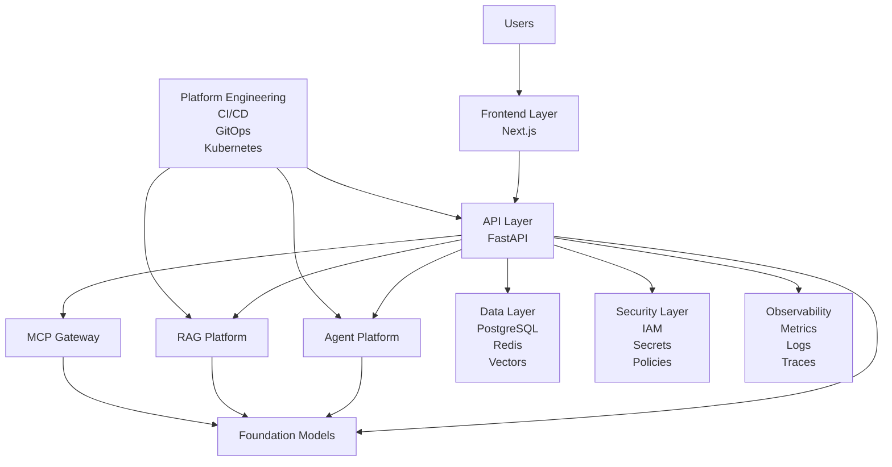

# AI Cloud MLOps Platform

[](https://aws.amazon.com/)
[](https://azure.microsoft.com/)
[](https://cloud.google.com/)
[](https://www.terraform.io/)
[](https://fastapi.tiangolo.com/)
[](https://python.org)
[](LICENSE)

---

# Enterprise AI Platform

> Enterprise-grade AI Platform covering Retrieval-Augmented Generation (RAG), Agentic AI, Model Context Protocol (MCP), MLOps, AWS Bedrock, SageMaker, Terraform, DevSecOps, Multi-Agent Systems and Multi-Cloud deployments across AWS, Azure, Google Cloud Platform and Vercel.

The objective of this repository is to provide a complete reference implementation for designing, building, deploying and operating production-grade AI platforms using modern cloud-native engineering practices.

---

# Table of Contents

- [Vision](#vision)
- [Objectives](#objectives)
- [Platform Scope](#platform-scope)
- [Technology Stack](#technology-stack)
- [Architecture Overview](#architecture-overview)
- [Architecture Principles](#architecture-principles)
- [Repository Structure](#repository-structure)
- [Documentation Hub](#documentation-hub)
- [Learning Roadmap](#learning-roadmap)
- [Enterprise Standards](#enterprise-standards)
- [Current Status](#current-status)
- [Contributing](#contributing)
- [License](#license)

---

# Vision

Artificial Intelligence is rapidly evolving from experimentation into mission-critical production systems.

Modern organizations need platforms capable of supporting:

- Generative AI
- Agentic Workflows
- Retrieval-Augmented Generation
- Multi-Agent Systems
- Governed AI Operations
- Enterprise Security
- Cloud Automation
- Multi-Cloud Deployments

This repository serves as a continuously evolving blueprint for building enterprise-grade AI systems that can scale from a single proof of concept to a global production platform.

---

# Objectives

Build production-ready AI systems that are:

- Scalable
- Secure
- Observable
- Resilient
- Cost-Aware
- Cloud-Native
- Vendor-Neutral
- Maintainable
- Extensible
- Enterprise-Ready

The platform emphasizes engineering excellence, operational maturity and long-term maintainability.

---

# Platform Scope

The platform covers the full AI application lifecycle.

## AI Capabilities

- Retrieval-Augmented Generation (RAG)
- Agentic AI
- Multi-Agent Systems
- Foundation Models
- LLM Orchestration
- Prompt Engineering
- AI Evaluation
- Model Context Protocol (MCP)

## Platform Engineering

- Cloud Native Applications
- Container Orchestration
- Infrastructure as Code
- DevSecOps
- GitOps
- Continuous Delivery
- Platform Automation

## MLOps

- Training Pipelines
- Experiment Tracking
- Model Registry
- Model Evaluation
- Model Monitoring
- Drift Detection
- Feature Engineering

## Enterprise Architecture

- Identity & Access Management
- Security Governance
- FinOps
- Resilience Engineering
- Disaster Recovery
- Multi-Cloud Operations
- Architecture Governance

---

# Technology Stack

## Frontend

- Next.js
- React
- TypeScript
- Tailwind CSS
- Clerk Authentication

## Backend

- FastAPI
- Python
- REST APIs
- Async Services
- Event-Driven Components

## AI & Foundation Models

- AWS Bedrock
- Anthropic Claude
- OpenAI
- Open Source LLMs
- LangChain
- LangGraph

## Data Layer

- PostgreSQL
- Aurora
- Redis
- Vector Databases
- Object Storage

## MLOps

- SageMaker
- Model Registry
- Evaluation Pipelines
- Model Monitoring

## Infrastructure

- Terraform
- AWS
- Azure
- Google Cloud Platform
- Vercel

## Platform Engineering

- Docker
- Kubernetes
- GitHub Actions
- ArgoCD

## Observability

- LangFuse
- CloudWatch
- Grafana
- Prometheus
- OpenTelemetry

---

# Architecture Overview

The platform follows a layered enterprise architecture designed around scalability, maintainability, observability and cloud portability.

## Architectural Layers

### Experience Layer

User-facing applications and portals.

- Web Applications
- Management Dashboards
- Developer Portals

### API Layer

Unified interface to all platform services.

- FastAPI Services
- API Gateway
- Authentication
- Authorization

### Intelligence Layer

Core AI capabilities powering the platform.

- Agent Frameworks
- Multi-Agent Systems
- RAG Services
- MCP Services
- Model Routing

### Data Layer

Persistent and transient storage systems.

- PostgreSQL
- Aurora
- Redis
- Vector Databases
- Object Storage

### Platform Layer

Operational components.

- CI/CD
- GitOps
- MLOps
- Kubernetes

### Infrastructure Layer

Cloud resources supporting workloads.

- AWS
- Azure
- GCP
- Vercel

### Security Layer

Enterprise-grade protection mechanisms.

- IAM
- Encryption
- Secret Management
- Policy Enforcement

### Observability Layer

Platform monitoring and operational awareness.

- Metrics
- Logs
- Distributed Tracing
- AI Observability

---

# Architecture Principles

## API First

All platform capabilities are exposed through well-defined APIs.

## Infrastructure as Code

All infrastructure resources are managed using Terraform and GitOps principles.

## Security by Default

Security controls are integrated into every platform layer.

## Observability by Design

Logs, metrics, traces and AI telemetry are first-class citizens.

## Automation First

Every repeatable process should be automated.

## Cloud Neutral Architecture

Avoid unnecessary vendor lock-in whenever possible.

## Enterprise Governance

Architecture decisions are documented and traceable.

## Cost Efficiency

Cloud resources are designed with FinOps principles in mind.

---

# High-Level Architecture



---

# Repository Structure

```text
.
├── frontend/
├── backend/
├── agents/
├── rag/
├── mcp/
├── mlops/
├── infrastructure/
├── deployment/
├── observability/
├── security/
├── tests/
├── scripts/
├── examples/
│
├── docs/
│   ├── architecture/
│   ├── adr/
│   ├── diagrams/
│   ├── runbooks/
│   └── standards/
│
├── .github/
│
├── CONTRIBUTING.md
├── SECURITY.md
├── CODE_OF_CONDUCT.md
├── LICENSE
└── README.md
```

---

# Documentation Hub

Enterprise documentation is organized into dedicated domains.

## Cloud Foundation

| Domain | Documentation |
|----------|----------|
| Cloud Strategy | [cloud-strategy.md](docs/architecture/cloud-strategy.md) |
| Environment Strategy | [environment-strategy.md](docs/architecture/environment-strategy.md) |
| Multi-Cloud Mapping | [multi-cloud-mapping.md](docs/architecture/multi-cloud-mapping.md) |

## Cloud Platforms

| Domain | Documentation |
|----------|----------|
| AWS Architecture (Primary) | [aws-architecture.md](docs/architecture/aws-architecture.md) |
| Azure Architecture | [azure-architecture.md](docs/architecture/azure-architecture.md) |
| GCP Architecture | [gcp-architecture.md](docs/architecture/gcp-architecture.md) |

## Infrastructure

| Domain | Documentation |
|----------|----------|
| Network Architecture | [network-architecture.md](docs/architecture/network-architecture.md) |
| Container Platform Architecture | [container-platform.md](docs/architecture/container-platform.md) |
| Infrastructure as Code | [infrastructure-as-code.md](docs/architecture/infrastructure-as-code.md) |


## Security & Governance

| Domain | Documentation |
|----------|----------|
| Identity & Access Management (IAM) | docs/architecture/iam.md |
| Cloud Security Architecture | docs/architecture/security-architecture.md |
| Compliance & Governance | docs/architecture/compliance-governance.md |
| Cost Governance (FinOps) | docs/architecture/finops.md |

## Resilience & Recovery

| Domain | Documentation |
|----------|----------|
| Resilience Architecture | docs/architecture/resilience-architecture.md |
| Disaster Recovery | docs/architecture/disaster-recovery.md |

## Platform Engineering

| Domain | Documentation |
|----------|----------|
| DevSecOps Architecture | docs/architecture/devsecops.md |
| Observability Architecture | docs/architecture/observability.md |
| Operational Excellence | docs/architecture/operational-excellence.md |
| Service Management | docs/architecture/service-management.md |

## Data & AI

| Domain | Documentation |
|----------|----------|
| Data Platform Architecture | docs/architecture/data-platform.md |
| Database Architecture | docs/architecture/database-architecture.md |
| Analytics & AI Architecture | docs/architecture/analytics-ai.md |

## Enterprise Architecture

| Domain | Documentation |
|----------|----------|
| Application Architecture | docs/architecture/application-architecture.md |
| Integration Architecture | docs/architecture/integration-architecture.md |
| Reference Architectures | docs/architecture/reference-architectures.md |
| Architecture Decision Records (ADR) | docs/architecture/adr.md |
| Technology Roadmap | docs/architecture/roadmap.md |

## Architecture Artifacts

| Artifact | Location |
|-----------|-----------|
| Architecture Decision Records | docs/adr/ |
| Architecture Diagrams | docs/diagrams/ |
| Operational Runbooks | docs/runbooks/ |
| Engineering Standards | docs/standards/ |

## C4 Architecture Model

| Diagram | Description |
|----------|----------|
| C4 Level 1 | docs/diagrams/c4-system-context.md |
| C4 Level 2 | docs/diagrams/c4-container.md |
| C4 Level 3 Agent Platform | docs/diagrams/c4-agent-platform.md |
| C4 Level 3 RAG Platform | docs/diagrams/c4-rag-platform.md |
| C4 Level 4 Deployment | docs/diagrams/c4-deployment.md |
| Multi-Cloud Architecture | docs/diagrams/multi-cloud-architecture.md |

---

# Learning Roadmap

The platform roadmap follows an incremental enterprise adoption strategy.

## Phase 1 - Foundation

### Objectives

- Cloud Fundamentals
- Python Engineering
- FastAPI Foundations
- AWS Core Services
- Terraform Basics

### Deliverables

- Initial API Platform
- Infrastructure Foundation
- CI/CD Bootstrap

---

## Phase 2 - AI Platform Core

### Objectives

- Foundation Models
- AWS Bedrock
- Prompt Engineering
- AI Service Abstractions

### Deliverables

- Model Gateway
- Provider Routing
- AI Service Layer

---

## Phase 3 - Retrieval-Augmented Generation (RAG)

### Objectives

- Document Ingestion
- Embedding Pipelines
- Retrieval Systems
- Evaluation Frameworks

### Deliverables

- Enterprise RAG Platform
- Knowledge Base Services
- Retrieval Evaluation

---

## Phase 4 - Agent Engineering

### Objectives

- Agent Frameworks
- MCP Servers
- Tool Calling
- Multi-Agent Orchestration

### Deliverables

- Agent Platform
- MCP Integration Layer
- Autonomous Workflows

---

## Phase 5 - MLOps

### Objectives

- SageMaker
- Model Registry
- Experiment Tracking
- Model Monitoring

### Deliverables

- Automated ML Pipelines
- Evaluation Platform
- Monitoring Framework

---

## Phase 6 - Platform Engineering

### Objectives

- Kubernetes
- GitOps
- ArgoCD
- DevSecOps

### Deliverables

- Platform Automation
- Enterprise CI/CD
- Secure Delivery Pipelines

---

## Phase 7 - Enterprise Architecture

### Objectives

- IAM
- Security Governance
- FinOps
- Disaster Recovery
- Resilience Engineering

### Deliverables

- Governance Framework
- Security Baselines
- FinOps Controls

---

## Phase 8 - Multi-Cloud & Production Excellence

### Objectives

- Azure
- Google Cloud
- Hybrid Architectures
- Reliability Engineering

### Deliverables

- Multi-Cloud Deployments
- Enterprise Operating Model
- SRE Framework

---

# Enterprise Standards

The platform adopts industry-recognized architecture frameworks and engineering standards.

## Cloud Architecture

- AWS Well-Architected Framework
- Azure Cloud Adoption Framework
- Google Cloud Architecture Framework

## Software Engineering

- Twelve-Factor App Methodology
- Domain-Driven Design (DDD)
- Clean Architecture
- API First Design

## Cloud Native

- CNCF Best Practices
- Kubernetes Standards
- GitOps Principles
- Infrastructure as Code

## Security

- Zero Trust Architecture
- Security by Design
- Least Privilege Principle
- Defense in Depth

## FinOps

- FinOps Foundation Framework
- Cost Allocation Standards
- Resource Optimization Policies

## Observability

- OpenTelemetry
- Distributed Tracing
- SRE Practices
- Error Budget Methodology

## Governance

- Architecture Decision Records (ADR)
- Technology Standards
- Architecture Reviews
- Change Management

---

# Future Architecture Deliverables

The following architecture assets will progressively be delivered:

## C4 Model

- System Context Diagram
- Container Diagram
- Component Diagram
- Deployment Diagram

## Security Architecture

- Threat Modeling
- Security Controls Matrix
- Data Classification Framework

## Platform Architecture

- Landing Zone Architecture
- Kubernetes Architecture
- Platform Engineering Blueprint

## Operations

- Runbooks
- Incident Response
- Disaster Recovery Procedures

## Governance

- ADR Repository
- Engineering Standards
- Platform Policies

---

# Current Status

## Platform Phase

Foundation

## Version

0.1.0

## Maturity Level

Early Development

## Target State

Enterprise AI Platform

## Current Priorities

- Core Architecture
- RAG Platform
- Agent Frameworks
- MCP Integration
- Infrastructure Automation
- Documentation Expansion

---

# Contributing

Community contributions are welcome.

Before contributing, please review:

- [CONTRIBUTING.md](CONTRIBUTING.md)
- [CODE_OF_CONDUCT.md](CODE_OF_CONDUCT.md)
- [SECURITY.md](SECURITY.md)

## Areas of Contribution

- AI Engineering
- Agent Systems
- MCP Integrations
- Cloud Architecture
- MLOps
- Infrastructure as Code
- Platform Engineering
- Observability
- Security Engineering
- Documentation

---

# License

This project is distributed under the MIT License.

See [LICENSE](LICENSE) for details.

---

# Repository Philosophy

> Build AI systems as platforms, not prototypes.

The objective of this repository is not only to demonstrate modern AI technologies but to establish a repeatable blueprint for designing, deploying and operating enterprise-grade AI platforms capable of supporting production workloads at scale.

The repository evolves progressively across Cloud Architecture, AI Engineering, Platform Engineering, MLOps, Security, Observability and Multi-Cloud Operations while remaining aligned with modern enterprise architecture standards.

---

**AI Cloud MLOps Platform**

Enterprise AI • Agentic Systems • RAG • MCP • MLOps • Platform Engineering • Multi-Cloud