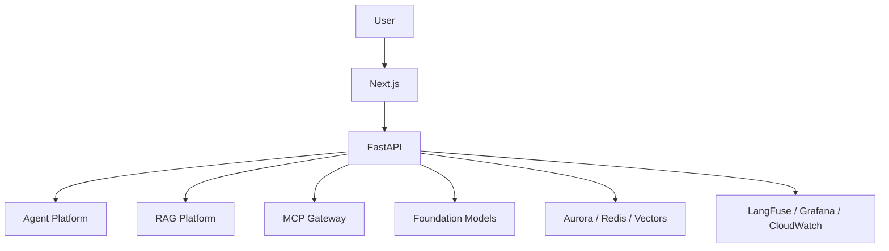

# AI Cloud MLOps Platform

> Enterprise-grade AI Platform covering RAG, Agents, MCP, MLOps, Bedrock, SageMaker, Terraform, CI/CD and Multi-Cloud deployments across AWS, Azure, GCP and Vercel.

---

## Vision

AI applications are moving from prototypes to production systems.

This repository aims to serve as a complete reference implementation for designing, building, deploying and operating enterprise-grade AI platforms.

The platform progressively covers:

- AI SaaS Architecture
- Cloud-Native Engineering
- MLOps
- Retrieval-Augmented Generation (RAG)
- Model Context Protocol (MCP)
- Agentic AI
- Multi-Agent Systems
- Infrastructure as Code
- Observability
- Security Engineering
- Multi-Cloud Deployments

---

## Objectives

Build production-ready systems that are:

- Scalable
- Secure
- Observable
- Cost-Aware
- Cloud-Native
- Maintainable
- Enterprise Ready

---

## Core Domains

### Frontend

- Next.js
- TypeScript
- Clerk Authentication

### Backend

- FastAPI
- REST APIs
- Agent Services

### AI Layer

- AWS Bedrock
- OpenAI
- Anthropic Claude
- Open Source Models

### RAG

- Ingestion
- Embeddings
- Retrieval
- Evaluation

### MCP

- GitHub MCP
- Filesystem MCP
- Database MCP
- Cloud MCP

### MLOps

- SageMaker
- Model Registry
- Monitoring
- Evaluation

### Infrastructure

- Terraform
- AWS
- Azure
- GCP
- Vercel

### Observability

- LangFuse
- CloudWatch
- Grafana
- Prometheus

---

## Repository Structure

```text
frontend/
backend/
agents/
rag/
mcp/
mlops/
infrastructure/
observability/
security/
deployment/
docs/
```

---

## Learning Path

### Week 1

Healthcare SaaS Application

### Week 2

AI Platform Engineering on AWS

### Week 3

Cyber Security Analyst Agent

### Week 4

Agentic Financial Planner

---

## Architecture Principles


### API First

All services expose well-defined APIs.

### Infrastructure as Code

All cloud resources are managed through Terraform.

### Security by Default

Security is integrated into every layer.

### Observability by Design

Metrics, traces and logs are first-class citizens.

### Cloud Neutral Architecture

Avoid unnecessary vendor lock-in.

---




## Current Status

Phase: Foundation

Version: 0.1.0

Status: In Development

---

## Contributing

See:

- CONTRIBUTING.md
- CODE_OF_CONDUCT.md
- SECURITY.md

---

## License

MIT License