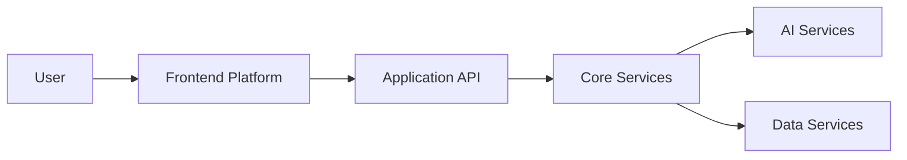
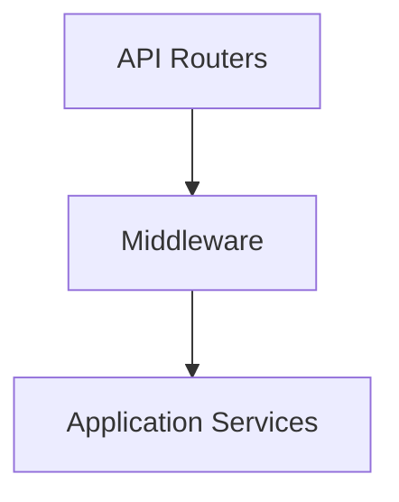
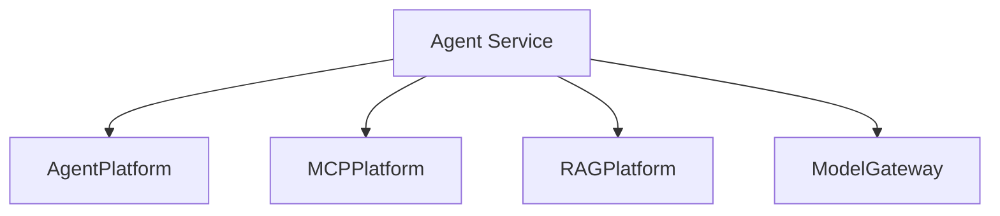
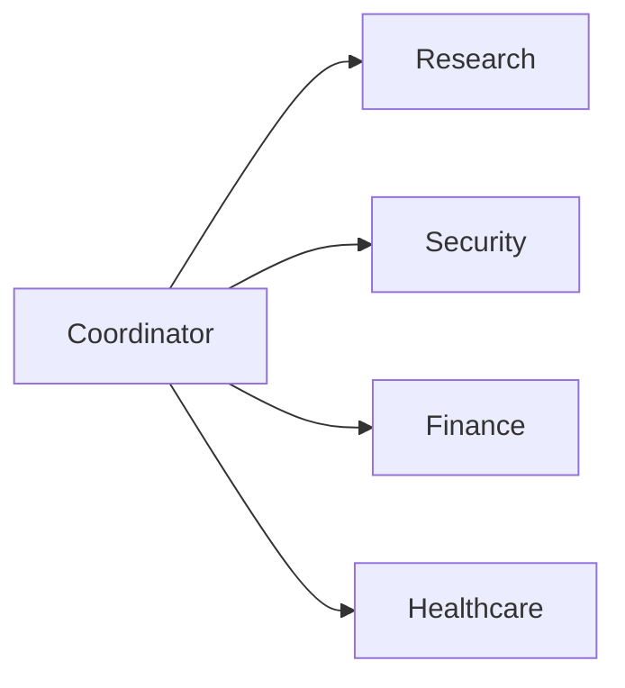
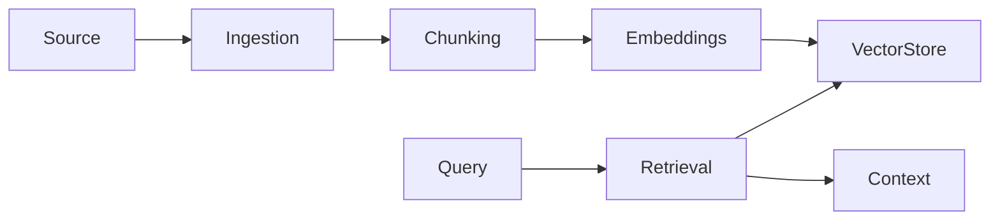
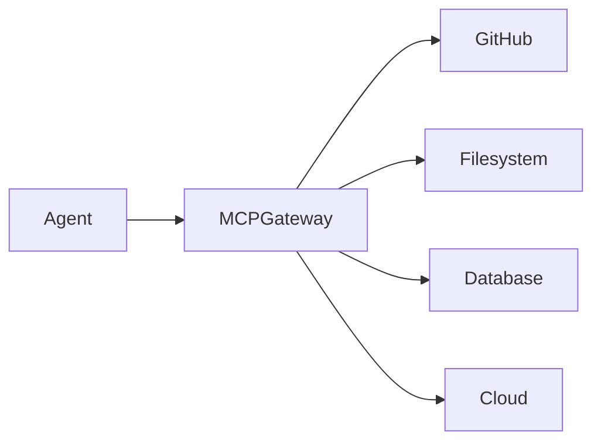
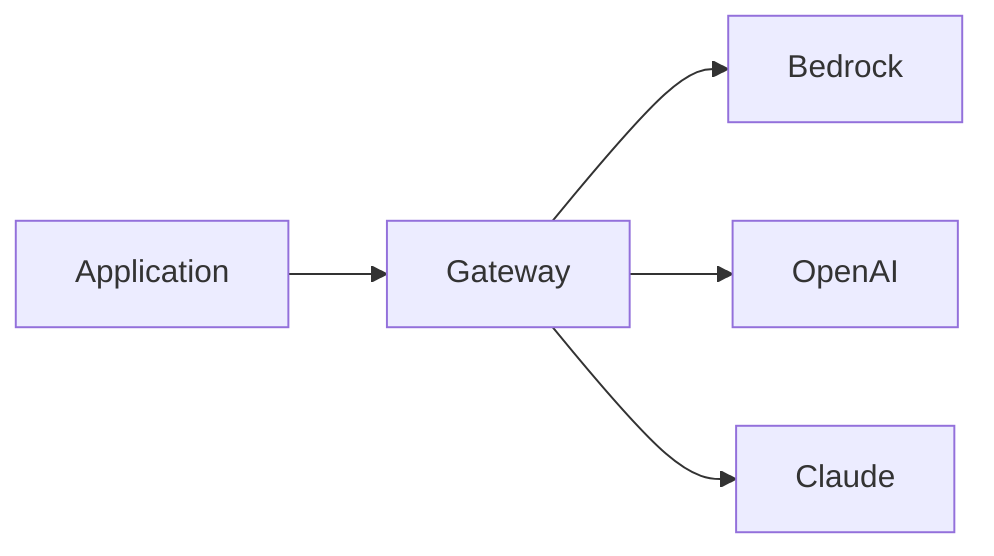
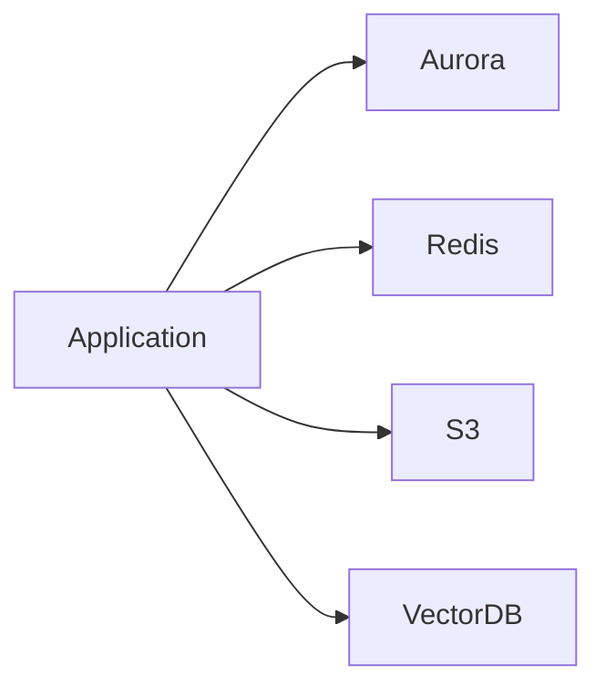

# Application Architecture

> Application architecture defining the structure, responsibilities, interactions and boundaries of all software components within the AI Cloud MLOps Platform.

---

# Purpose

This document describes the internal application architecture of the platform.

Its objective is to define:

- Application boundaries
- Internal components
- Service responsibilities
- Interactions between modules
- Architectural constraints
- Dependency rules

This document serves as the reference for application-level design and implementation.

---

# Architectural Style

The platform follows a modular service-oriented architecture.

Design principles:

- API First
- Domain Driven Organization
- Separation of Concerns
- Modular Design
- Loose Coupling
- High Cohesion

The architecture is designed to support:

- SaaS applications
- AI agents
- RAG systems
- MCP integrations
- Multi-cloud deployments

---

# High-Level Application Architecture



This view intentionally shows only the major application layers.

Detailed component views follow below.

---

# Layered Architecture

```text
Frontend Layer
        ↓
API Layer
        ↓
Application Services Layer
        ↓
AI Services Layer
        ↓
Data Services Layer
        ↓
Infrastructure Layer
```

Each layer may only interact with the layer immediately below it.

---

# Frontend Architecture

## Responsibilities

The frontend platform is responsible for:

- User Experience
- Authentication Experience
- Dashboard Rendering
- Subscription Management
- Agent Interfaces
- Administration Interfaces

---

## Technology Stack

```text
Next.js
TypeScript
React
Clerk
TailwindCSS
```

---

## Frontend Structure

```text
frontend/
└── nextjs-app/
    ├── app/
    ├── components/
    ├── services/
    ├── hooks/
    ├── lib/
    └── stores/
```

---

## Frontend Components

| Component | Responsibility |
|------------|------------|
| App Router | Route Management |
| Dashboard | User Workspace |
| Agent UI | Agent Interactions |
| RAG UI | Knowledge Search |
| Authentication UI | User Identity |
| Billing UI | Subscription Management |

---

# Backend Architecture

## Responsibilities

The backend serves as the central orchestration layer.

Responsibilities:

- API Management
- Business Logic
- Service Orchestration
- Security Enforcement
- Data Access

---

## Technology Stack

```text
Python
FastAPI
Pydantic
Uvicorn
```

---

## Backend Structure

```text
backend/

api/
services/
middleware/
workers/
shared/
```

---

## Backend Component Diagram



---

# Application Services Layer

This layer contains business capabilities.

---

## Responsibilities

- Workflow Management
- Validation
- Agent Invocation
- Data Coordination
- Process Automation

---

## Services

| Service | Responsibility |
|----------|----------|
| User Service | User Management |
| Agent Service | Agent Coordination |
| RAG Service | Retrieval Workflows |
| MCP Service | Tool Integration |
| Model Service | LLM Access |
| Billing Service | Subscriptions |

---

# AI Services Architecture

The AI layer encapsulates all intelligence capabilities.

---

## AI Component Diagram



---

## AI Responsibilities

- Agent Execution
- Context Enrichment
- Model Selection
- Tool Usage
- Workflow Orchestration

---

# Agent Platform

The Agent Platform provides reusable intelligent agents.

---

## Agents

| Agent | Purpose |
|---------|---------|
| Research Agent | Analysis & Research |
| Security Agent | Threat Investigation |
| Healthcare Agent | Medical Knowledge Assistance |
| Finance Agent | Financial Planning |
| Coordinator Agent | Agent Orchestration |

---

## Agent Architecture



---

# RAG Platform

The RAG Platform enriches AI responses with enterprise knowledge.

---

## Responsibilities

- Content Ingestion
- Chunking
- Embedding Generation
- Retrieval
- Reranking

---

## RAG Architecture



---

# MCP Platform

The MCP Platform provides standardized access to external systems.

---

## Responsibilities

- Tool Discovery
- Tool Invocation
- Resource Access
- External Integrations

---

## MCP Architecture



---

# Model Gateway

The platform uses a unified Model Gateway.

Applications never communicate directly with model providers.

---

## Benefits

- Vendor abstraction
- Standardized prompts
- Provider interchangeability
- Centralized governance

---

## Providers

```text
AWS Bedrock
OpenAI
Anthropic Claude
DeepSeek
Mistral
Llama
```

---

## Gateway Architecture



---

# Data Services

The Data Services Layer manages persistent and transient information.

---

## Responsibilities

- Persistence
- Knowledge Storage
- Caching
- Retrieval

---

## Storage Components

| Component | Purpose |
|------------|------------|
| Aurora Serverless | Transactional Data |
| Redis | Cache |
| S3 | Knowledge Repository |
| Vector DB | Semantic Search |

---

## Data Architecture



---

# Cross-Cutting Concerns

The following capabilities apply to all layers.

---

## Security

Capabilities:

- Authentication
- Authorization
- Secret Management
- Encryption

---

## Observability

Capabilities:

- Logs
- Metrics
- Traces

Tools:

- LangFuse
- CloudWatch
- Grafana

---

## Auditability

All critical actions must be traceable and auditable.

---

# Dependency Rules

The following dependency rules must be respected.

## Frontend

May depend on:

```text
API Layer
```

Must not depend on:

```text
Infrastructure
Database
```

---

## Services Layer

May depend on:

```text
AI Layer
Data Layer
```

Must not depend directly on:

```text
Frontend
```

---

## Agents

May depend on:

```text
RAG
MCP
Model Gateway
```

Must not depend directly on:

```text
Frontend
```

---

# Related Documents

- enterprise-architecture.md
- cloud-architecture.md
- data-architecture.md
- security-architecture.md
- deployment-architecture.md

---

# Related ADRs

- ADR-003 Agent Framework
- ADR-006 Model Gateway
- ADR-007 RAG Platform
- ADR-009 Infrastructure as Code

---

# Conclusion

The Application Architecture defines the structure and interactions of all software components within the AI Cloud MLOps Platform.

Its modular design enables independent evolution of frontend, application services, AI capabilities and data services while maintaining clear boundaries, governance and extensibility.