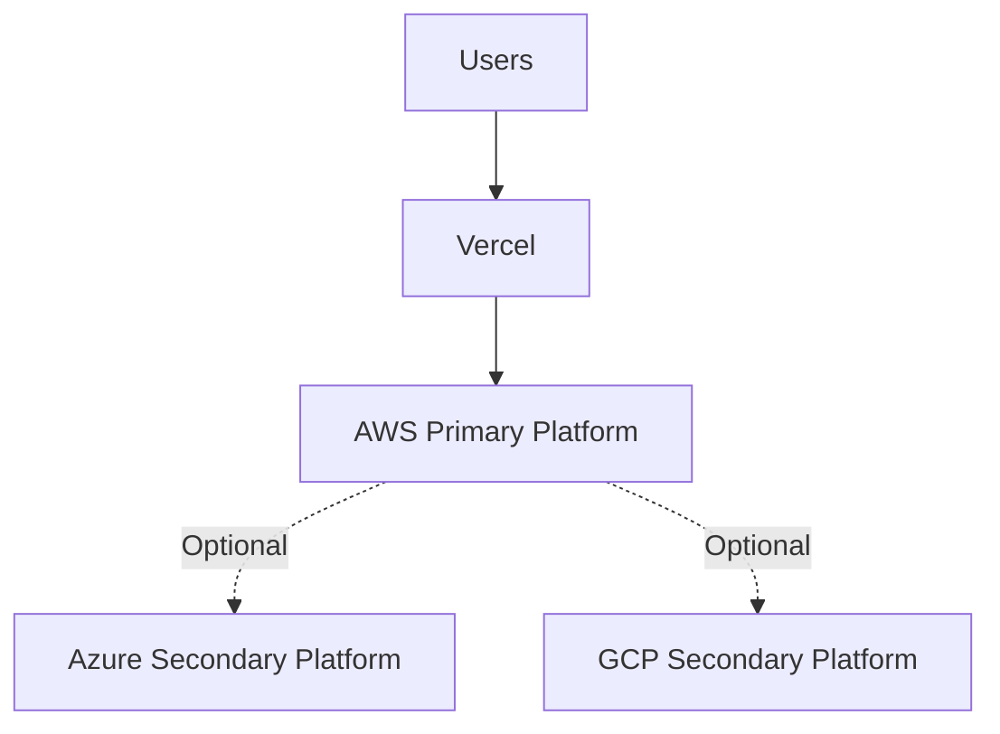
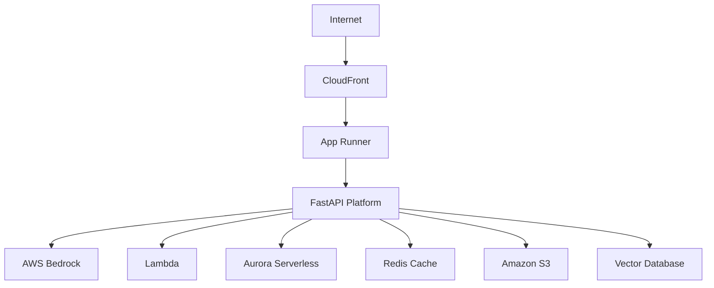
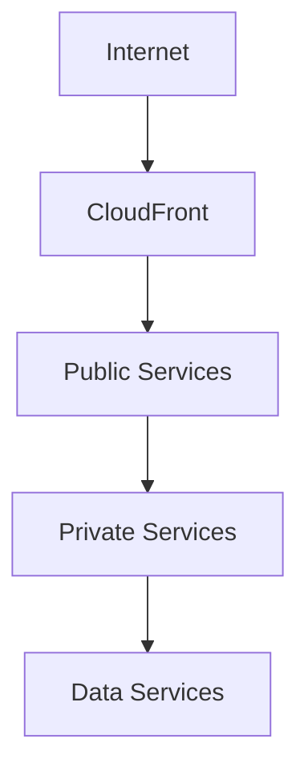
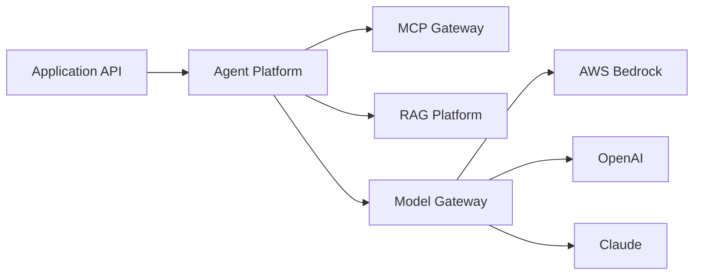
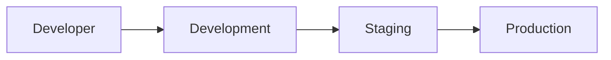
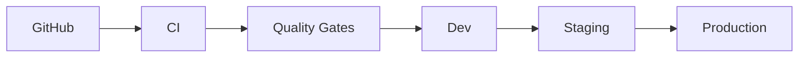
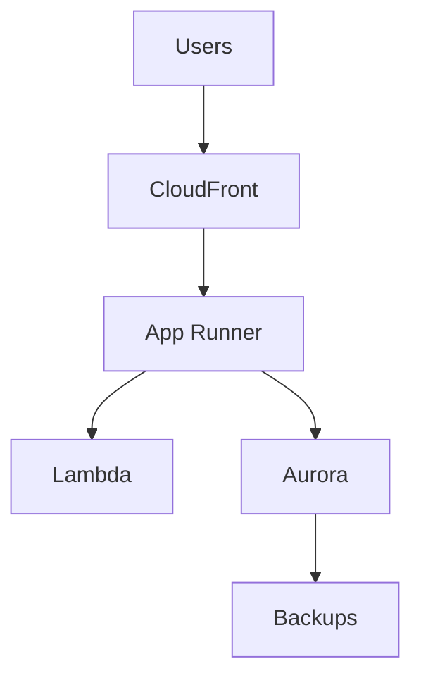
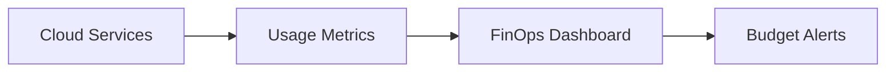

## Cloud Strategy Overview

## AWS Reference Architecture

## Network Architecture

## AI Platform Architecture

## Environment Strategy

## Deployment Pipeline

## Resilience Architecture

## Cost Governance

