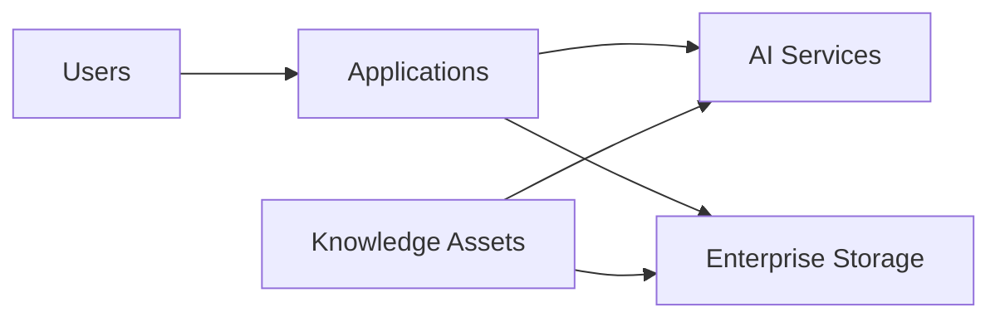
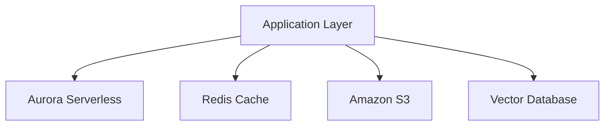
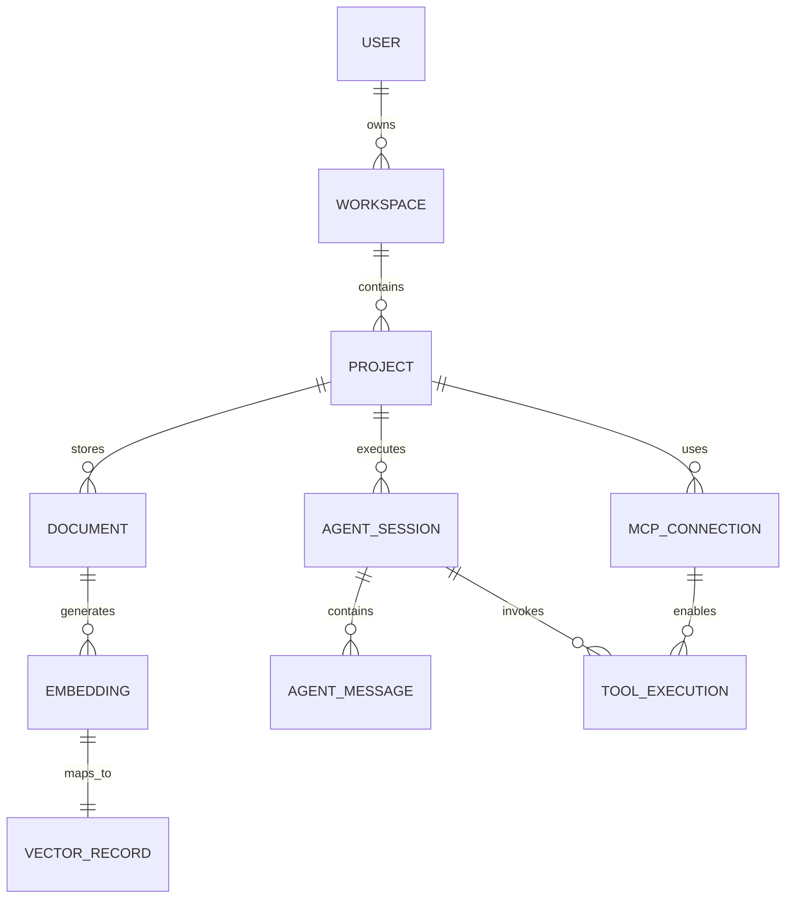
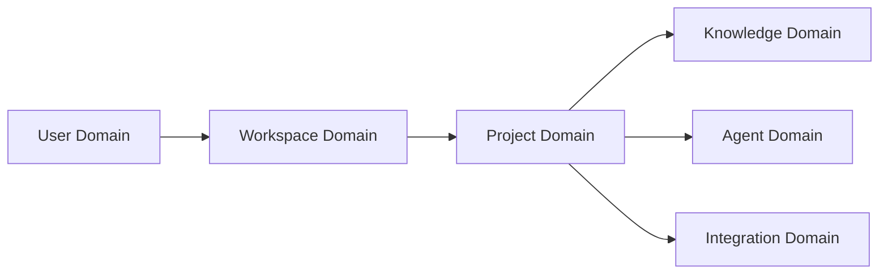
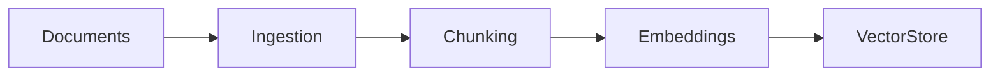
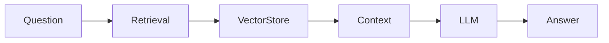
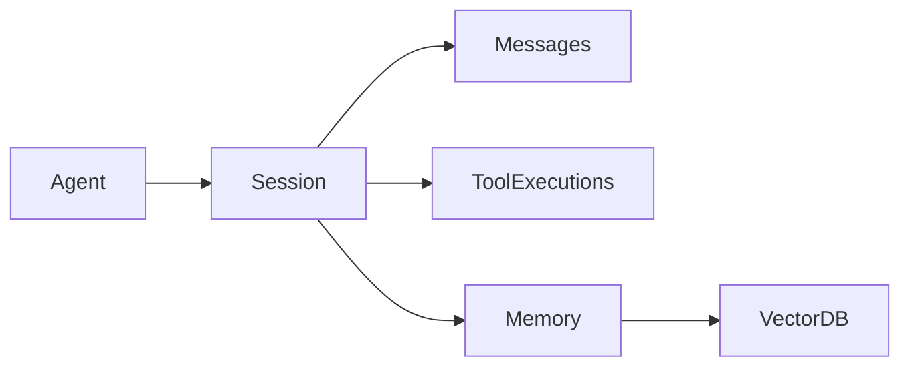
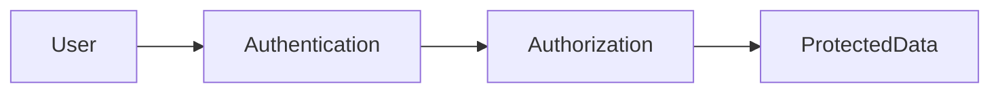

# Data Architecture

> Enterprise Data Architecture for the AI Cloud MLOps Platform.

---

# Purpose

This document defines how data is created, stored, processed, secured, retrieved and governed across the platform.

The architecture supports both traditional application workloads and AI-native workloads including:

- SaaS Applications
- AI Agents
- Multi-Agent Systems
- Retrieval-Augmented Generation (RAG)
- MCP Integrations
- Observability
- MLOps

The objective is to establish a scalable, secure and maintainable foundation for managing enterprise data assets.

---

# Architecture Principles

## Single Source of Truth

Each domain must have a clearly identified system of record.

Data duplication should be minimized whenever possible.

---

## Security by Design

Security controls are applied throughout the entire data lifecycle.

Controls include:

- Encryption at Rest
- Encryption in Transit
- Access Control
- Data Classification
- Audit Logging

---

## Data Lifecycle Management

Every data asset must follow a defined lifecycle.

```text
Create
  ↓
Store
  ↓
Process
  ↓
Retrieve
  ↓
Archive
  ↓
Delete
```

---

## AI-Native Data Strategy

Knowledge is treated as a strategic enterprise asset.

Knowledge is:

- Collected
- Processed
- Embedded
- Indexed
- Retrieved
- Reused

through the RAG platform.

---

# Data Domains

| Domain | Description |
|----------|----------|
| Identity | Users, Roles, Access Rights |
| Collaboration | Workspaces, Projects |
| Knowledge | Documents, Content, Embeddings |
| Agentic AI | Agent Sessions, Agent Messages |
| Integration | MCP Connections, Tool Executions |
| Observability | Logs, Metrics, Traces |
| Security | Audit Events, Access Events |

---

# High-Level Data Architecture



---

# Data Storage Architecture

## Overview

The platform uses specialized storage systems optimized for different workloads.



---

# Storage Responsibilities

## Aurora Serverless

Purpose:

- User Accounts
- Workspaces
- Projects
- Agent Sessions
- MCP Connections
- Business Data

Characteristics:

- Relational Storage
- ACID Transactions
- High Consistency

---

## Redis

Purpose:

- Caching
- Session Storage
- Temporary Context
- Agent Memory Cache

Characteristics:

- In-Memory
- Low Latency
- High Performance

---

## Amazon S3

Purpose:

- Raw Documents
- Knowledge Assets
- Uploaded Files
- Training Assets

Characteristics:

- Durable
- Cost Effective
- Scalable

---

## Vector Database

Purpose:

- Embeddings
- Semantic Search
- Similarity Matching
- Agent Memory

Characteristics:

- Vector Native
- AI Optimized
- Fast Retrieval

---

# Logical Data Model

The following model describes the major business entities.



---

# Cardinalities and Constraints

## USER → WORKSPACE

Cardinality:

```text
1 : N
```

Rules:

- A user may own multiple workspaces.
- A workspace belongs to a single owner.

---

## WORKSPACE → PROJECT

Cardinality:

```text
1 : N
```

Rules:

- A project belongs to exactly one workspace.

---

## PROJECT → DOCUMENT

Cardinality:

```text
1 : N
```

Rules:

- Documents must belong to a project.

---

## PROJECT → AGENT SESSION

Cardinality:

```text
1 : N
```

Rules:

- Multiple agent executions may exist for the same project.

---

## DOCUMENT → EMBEDDING

Cardinality:

```text
1 : N
```

Rules:

- A document may generate multiple embeddings.

---

## EMBEDDING → VECTOR RECORD

Cardinality:

```text
1 : 1
```

Rules:

- Each embedding maps to exactly one vector record.

---

## AGENT SESSION → AGENT MESSAGE

Cardinality:

```text
1 : N
```

Rules:

- A session contains at least one message.

---

## AGENT SESSION → TOOL EXECUTION

Cardinality:

```text
1 : N
```

Rules:

- A session may invoke multiple tools.

---

# Business Constraints

## User Constraints

```text
EMAIL must be unique.

ROLE must be defined.

USER_ID must be immutable.
```

---

## Workspace Constraints

```text
Workspace names must be unique within an owner scope.
```

---

## Project Constraints

Allowed statuses:

```text
ACTIVE
PAUSED
ARCHIVED
DELETED
```

---

## Document Constraints

Allowed source types:

```text
PDF
WEB
SHAREPOINT
S3
CSV
JSON
```

---

## Agent Session Constraints

Allowed agent types:

```text
RESEARCH
HEALTHCARE
SECURITY
FINANCE
COORDINATOR
```

---

## Tool Execution Constraints

Allowed statuses:

```text
PENDING
RUNNING
SUCCESS
FAILED
TIMEOUT
```

---

# Domain Ownership Model



---

# Knowledge Architecture

The platform uses Retrieval-Augmented Generation (RAG) to enrich AI responses with enterprise knowledge.

---

## Knowledge Ingestion Pipeline



---

## Supported Sources

- PDF
- SharePoint
- Websites
- Amazon S3
- CSV
- JSON
- Knowledge Repositories

---

# Retrieval Architecture



---

# Agent Data Architecture

AI agents generate specialized data structures.



---

# Agent Memory Strategy

| Memory Type | Storage |
|-------------|-------------|
| Session Memory | Redis |
| Short-Term Memory | Redis |
| Long-Term Memory | Vector Database |
| Business Data | Aurora |
| Knowledge Assets | S3 |

---

# Data Security Architecture



---

# Data Classification

| Classification | Examples |
|---------------|----------|
| Public | Documentation |
| Internal | Project Metadata |
| Confidential | User Data |
| Restricted | Security Events, Secrets |

---

# Data Ownership Matrix

| Data Asset | System of Record |
|------------|-----------------|
| Users | Aurora |
| Workspaces | Aurora |
| Projects | Aurora |
| Agent Sessions | Aurora |
| Agent Messages | Aurora |
| Documents | S3 |
| Embeddings | Vector Database |
| Vectors | Vector Database |
| Cache Data | Redis |
| Logs | CloudWatch |
| Traces | LangFuse |

---

# Data Governance

Core principles:

- Ownership
- Traceability
- Auditability
- Compliance
- Lifecycle Management
- Data Quality

---

# Data Observability

The platform continuously monitors:

- Data Availability
- Data Quality
- Retrieval Quality
- Storage Growth
- Embedding Generation
- Semantic Search Performance

Tooling:

- LangFuse
- CloudWatch
- Grafana
- Prometheus

---

# Future Data Capabilities

Planned extensions include:

- Agent Memory Persistence
- Prompt Registry
- Model Registry
- Cost Tracking
- Workflow Storage
- Human Feedback Storage
- Evaluation Datasets
- FinOps Analytics
- Data Quality Monitoring

---

# Related Documents

- enterprise-architecture.md
- application-architecture.md
- cloud-architecture.md
- security-architecture.md
- deployment-architecture.md

---

# Related ADRs

- ADR-002 Vector Database Strategy
- ADR-006 Model Gateway
- ADR-007 RAG Platform
- ADR-008 Security by Design

---

# Conclusion

The Data Architecture provides the foundation for managing transactional, operational and AI-native data across the platform.

By separating business data, knowledge assets, semantic retrieval data and observability data into dedicated domains and storage systems, the platform remains scalable, secure, observable and enterprise-ready.