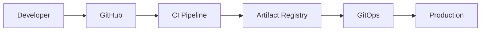
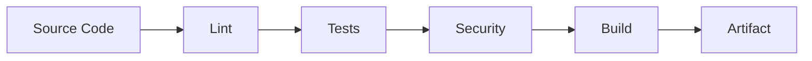
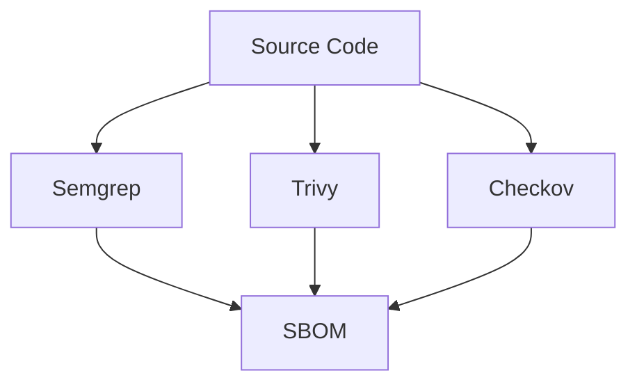
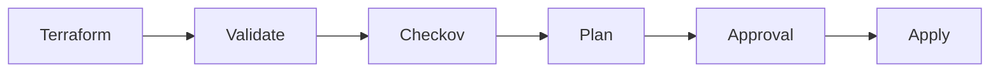
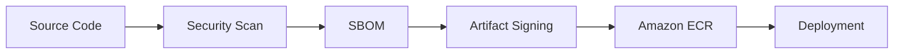
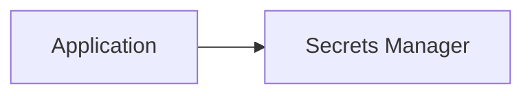
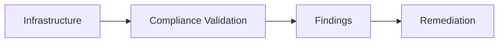
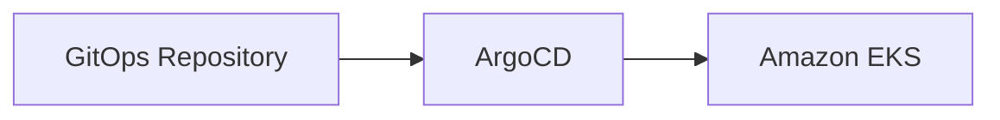
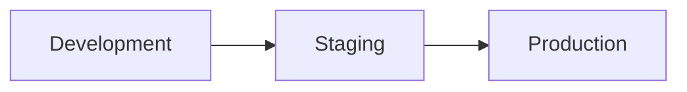
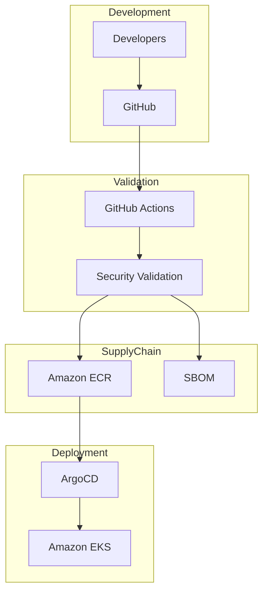

# DevSecOps Architecture

> Enterprise DevSecOps Architecture for the AI Cloud MLOps Platform, integrating software delivery, infrastructure automation, cloud security, compliance, governance, GitOps, supply chain security, and continuous deployment into a unified operating model.

---

# Table of Contents

- [Overview](#overview)
- [Objectives](#objectives)
- [DevSecOps Principles](#devsecops-principles)
- [Architecture Overview](#architecture-overview)
- [Operating Model](#operating-model)
- [Software Delivery Lifecycle](#software-delivery-lifecycle)
- [Source Control Strategy](#source-control-strategy)
- [Branching Strategy](#branching-strategy)
- [CI Architecture](#ci-architecture)
- [Quality Validation](#quality-validation)
- [Continuous Integration Pipeline](#continuous-integration-pipeline)
- [Security Integration](#security-integration)
- [Security Gates Architecture](#security-gates-architecture)
- [Static Application Security Testing](#static-application-security-testing)
- [Software Composition Analysis](#software-composition-analysis)
- [Infrastructure Security Validation](#infrastructure-security-validation)
- [Policy As Code](#policy-as-code)
- [Infrastructure Delivery](#infrastructure-delivery)
- [Software Supply Chain Security](#software-supply-chain-security)
- [Supply Chain Controls](#supply-chain-controls)
- [SBOM Strategy](#sbom-strategy)
- [Artifact Management](#artifact-management)
- [Container Security](#container-security)

---

# Overview

The DevSecOps architecture establishes the delivery framework for building, securing, testing, deploying and operating enterprise AI workloads.

The objective is to integrate security directly into software delivery rather than treating it as a separate activity.

The platform adopts:

- Continuous Integration
- Continuous Delivery
- GitOps
- Infrastructure as Code
- Policy as Code
- Continuous Security
- Automated Compliance
- Supply Chain Security

[⬆ Back to TOC](#table-of-contents)

---

# Objectives

## Speed

Accelerate software delivery.

## Security

Embed security throughout the lifecycle.

## Reliability

Reduce deployment risks.

## Compliance

Automate governance controls.

## Repeatability

Eliminate manual processes.

## Traceability

Ensure every change is auditable.

[⬆ Back to TOC](#table-of-contents)

---

# DevSecOps Principles

## Everything as Code

The platform manages:

- Infrastructure as Code
- Policy as Code
- Security as Code
- Observability as Code
- Compliance as Code

## Shift Left Security

Security validation occurs as early as possible.

## Continuous Verification

Every change is continuously validated.

## Git As Source Of Truth

Git repositories are authoritative.

## Immutable Deployments

Deployments replace infrastructure rather than modifying it.

## Zero Trust Delivery

Every artifact must be validated before deployment.

[⬆ Back to TOC](#table-of-contents)

---

# Architecture Overview

```text
Developer
      ↓
GitHub
      ↓
CI Pipeline
      ↓
Security Validation
      ↓
Artifact Creation
      ↓
Artifact Registry
      ↓
GitOps Repository
      ↓
ArgoCD
      ↓
Production
```

[⬆ Back to TOC](#table-of-contents)

---

# Operating Model

```text
Build
  ↓
Scan
  ↓
Validate
  ↓
Deploy
  ↓
Observe
  ↓
Improve
```

[⬆ Back to TOC](#table-of-contents)

---

# Software Delivery Lifecycle



[⬆ Back to TOC](#table-of-contents)

---

# Source Control Strategy

GitHub is the enterprise source control platform.

## Repository Types

### Application Repositories

```text
frontend
backend
agents
rag
mcp
```

### Infrastructure Repositories

```text
terraform
platform
landing-zone
```

### GitOps Repositories

```text
environments
clusters
applications
```

[⬆ Back to TOC](#table-of-contents)

---

# Branching Strategy

## Main

Production-ready code.

## Develop

Integration branch.

## Feature

```text
feature/*
```

## Hotfix

```text
hotfix/*
```

[⬆ Back to TOC](#table-of-contents)

---

# CI Architecture

Every Pull Request triggers validation.

## CI Workflow



[⬆ Back to TOC](#table-of-contents)

---

# Quality Validation

## Source Validation

Controls:

- Formatting
- Static Analysis
- Secret Detection

## Build Validation

Controls:

- Dependency Resolution
- Package Integrity
- Reproducible Builds

## Test Validation

Controls:

- Unit Tests
- Integration Tests
- End-To-End Tests

## Security Validation

Controls:

- SAST
- SCA
- IaC Scanning
- Container Scanning

[⬆ Back to TOC](#table-of-contents)

---

# Continuous Integration Pipeline

## Stage 1 – Code Quality

Tools:

- Ruff
- Black
- MyPy
- ESLint

## Stage 2 – Testing

Validation:

```text
Unit Tests
Integration Tests
API Tests
Agent Tests
RAG Tests
```

Target:

```text
80%+ Coverage
```

## Stage 3 – Security Validation

Validation:

```text
SAST
Dependency Scanning
Secrets Detection
IaC Scanning
```

## Stage 4 – Build

Outputs:

```text
Container Images
Packages
Terraform Artifacts
```

## Stage 5 – Publishing

```text
Amazon ECR
Artifact Storage
SBOM Repository
```

[⬆ Back to TOC](#table-of-contents)

---

# Security Integration

Security controls are embedded throughout the delivery lifecycle.

| Stage | Controls |
|---------|---------|
| Commit | Secret Detection |
| Build | Dependency Scanning |
| Test | SAST |
| Package | SBOM |
| Registry | Image Scanning |
| Deploy | Admission Policies |
| Runtime | Monitoring |

[⬆ Back to TOC](#table-of-contents)

---

# Security Gates Architecture



[⬆ Back to TOC](#table-of-contents)

---

# Static Application Security Testing

## Technologies

- Semgrep
- CodeQL
- Bandit

## Objectives

- Detect vulnerabilities
- Identify insecure coding patterns
- Enforce secure development practices

[⬆ Back to TOC](#table-of-contents)

---

# Software Composition Analysis

## Technologies

- Trivy
- Snyk
- Dependabot

## Objectives

- Detect vulnerable dependencies
- Track CVEs
- Monitor supply chain risks

[⬆ Back to TOC](#table-of-contents)

---

# Infrastructure Security Validation

## Technologies

- Checkov
- Tfsec

## Controls

- Encryption Validation
- Security Group Validation
- IAM Validation
- Compliance Checks

[⬆ Back to TOC](#table-of-contents)

---

# Policy As Code

## Technologies

- OPA
- Gatekeeper
- Kyverno
- AWS Config
- Service Control Policies

## Policy Domains

- Security
- Compliance
- Infrastructure
- Kubernetes

[⬆ Back to TOC](#table-of-contents)

---

# Infrastructure Delivery

## Infrastructure Pipeline



[⬆ Back to TOC](#table-of-contents)

---

# Software Supply Chain Security

The platform follows modern supply chain security standards.

## Security Objectives

- Artifact Integrity
- Provenance Validation
- Vulnerability Reduction
- Dependency Governance
- Signed Artifacts
- Trusted Delivery

## Software Supply Chain



[⬆ Back to TOC](#table-of-contents)

---

# Supply Chain Controls

## Provenance Verification

Every artifact must be traceable.

## Artifact Signing

All production artifacts must be signed.

## Dependency Governance

Dependencies are monitored continuously.

## Trust Enforcement

Only trusted artifacts can be deployed.

[⬆ Back to TOC](#table-of-contents)

---

# SBOM Strategy

Formats:

- SPDX
- CycloneDX

Benefits:

- Dependency Visibility
- Vulnerability Tracking
- Compliance Evidence
- Supply Chain Governance

[⬆ Back to TOC](#table-of-contents)

---

# Artifact Management

Primary Registry:

```text
Amazon ECR
```

Artifacts must be:

- Immutable
- Versioned
- Signed
- Scanned
- Traceable

[⬆ Back to TOC](#table-of-contents)

---

# Container Security

## Mandatory Controls

- Non-root Containers
- Read-only Filesystems
- Image Signing
- Vulnerability Scanning
- Minimal Base Images

## Approved Base Images

```text
Distroless
Alpine
Official Vendor Images
```

## Container Scanning

- Trivy
- AWS Inspector

## Container Security Matrix

| Control | Mandatory |
|----------|-


# Kubernetes Security

Kubernetes workloads are protected using layered security controls.

---

## Kubernetes Security Principles

- Least Privilege
- Zero Trust
- Defense in Depth
- Immutable Infrastructure
- Continuous Verification

---

## Cluster Security Controls

| Control | Description |
|----------|----------|
| RBAC | Identity Authorization |
| Network Policies | East-West Traffic Control |
| Pod Security Standards | Secure Workloads |
| Admission Controllers | Policy Enforcement |
| Audit Logging | Activity Tracking |
| Runtime Detection | Threat Detection |

---

## Security Enforcement Stack

```text
IAM
 ↓
IRSA
 ↓
RBAC
 ↓
Network Policies
 ↓
Admission Controllers
 ↓
Runtime Security
```

---

## Admission Control

Technologies:

- Kyverno
- OPA Gatekeeper

Objectives:

- Prevent insecure deployments
- Enforce standards
- Block non-compliant resources

---

## Runtime Security

Technologies:

- Falco
- GuardDuty EKS Protection
- Security Hub

Capabilities:

- Threat Detection
- Runtime Monitoring
- Container Protection
- Incident Investigation

---

<a href="#table-of-contents">⬆ Back to Table of Contents</a>

---

# Secret Management

Secrets must never be stored in source code repositories.

---

## Approved Secret Stores

### AWS Secrets Manager

Production Secret Storage.

### AWS Systems Manager Parameter Store

Infrastructure and service parameters.

### GitHub Actions Secrets

CI/CD integrations only.

---

## Secret Management Flow



---

## Secret Management Controls

| Control | Mandatory |
|----------|----------|
| Encryption | Yes |
| Rotation | Yes |
| Audit Logging | Yes |
| Least Privilege | Yes |
| Access Monitoring | Yes |

---

## Rotation Policy

| Secret Type | Rotation |
|------------|------------|
| API Keys | 90 Days |
| Access Tokens | 90 Days |
| Database Credentials | 90 Days |
| Certificates | 12 Months |

---

<a href="#table-of-contents">⬆ Back to Table of Contents</a>

---

# Compliance Automation

Compliance validation executes continuously.

---

## Compliance Frameworks

Supported:

- ISO 27001
- SOC 2
- GDPR
- NIST
- CIS Benchmarks

---

## Automated Controls

- AWS Config
- Security Hub
- Terraform Validation
- Checkov
- Policy Validation
- Continuous Monitoring

---

## Compliance Pipeline



---

## Compliance Evidence Sources

- CloudTrail
- AWS Config
- Security Hub
- Audit Logs
- Git History
- Terraform State

---

<a href="#table-of-contents">⬆ Back to Table of Contents</a>

---

# GitOps Architecture

GitOps is the deployment mechanism for all Kubernetes workloads.

---

## GitOps Principles

- Git is the source of truth
- Desired state is versioned
- Reconciliation is automated
- Rollbacks are simplified
- Drift is detected automatically

---

## GitOps Deployment Flow



---

## GitOps Components

| Component | Purpose |
|------------|------------|
| GitHub | Desired State |
| ArgoCD | Continuous Reconciliation |
| Helm | Packaging |
| Kustomize | Environment Configuration |

---

<a href="#table-of-contents">⬆ Back to Table of Contents</a>

---

# Continuous Delivery

Deployment automation enables repeatable releases.

---

## Continuous Delivery Flow

```text
Build
 ↓
Security Validation
 ↓
Artifact Registry
 ↓
GitOps Repository
 ↓
ArgoCD
 ↓
Production
```

---

## Deployment Types

### Standard Release

Scheduled deployment.

### Hotfix Release

Urgent defect correction.

### Emergency Release

Incident remediation.

---

<a href="#table-of-contents">⬆ Back to Table of Contents</a>

---

# Environment Promotion Model

Workloads progress through controlled environments.

---

## Promotion Strategy



---

## Promotion Requirements

### Development → Staging

- Successful Build
- Unit Tests
- Security Validation
- Infrastructure Validation

### Staging → Production

- Integration Validation
- Performance Validation
- Security Approval
- Business Approval

---

## Release Gates Matrix

| Gate | Development | Staging | Production |
|----------|----------|----------|----------|
| Unit Tests | ✅ | ✅ | ✅ |
| Integration Tests | ❌ | ✅ | ✅ |
| Security Scan | ✅ | ✅ | ✅ |
| Performance Tests | ❌ | ✅ | ✅ |
| Compliance Checks | ❌ | ✅ | ✅ |
| Approval Required | ❌ | ✅ | ✅ |

---

<a href="#table-of-contents">⬆ Back to Table of Contents</a>

---

# Release Management

## Release Types

| Release | Description |
|----------|----------|
| Feature Release | New Features |
| Maintenance Release | Improvements |
| Hotfix Release | Bug Fixes |
| Emergency Release | Incident Recovery |

---

## Release Requirements

- Validated Artifact
- Security Approval
- Compliance Validation
- Deployment Plan

---

## Versioning Strategy

```text
MAJOR.MINOR.PATCH

1.0.0
```

---

<a href="#table-of-contents">⬆ Back to Table of Contents</a>

---

# Change Management

Every production change must be documented, reviewed and auditable.

---

## Change Categories

| Category | Approval |
|----------|----------|
| Standard | Automated |
| Normal | Change Approval |
| Emergency | Emergency Approval |

---

## Change Lifecycle

```text
Request
 ↓
Review
 ↓
Approval
 ↓
Implementation
 ↓
Validation
 ↓
Closure
```

---

<a href="#table-of-contents">⬆ Back to Table of Contents</a>

---

# Quality Gates

Every deployment must pass mandatory validation gates.

---

## Quality Gates Matrix

| Gate | Mandatory |
|----------|----------|
| Linting | Yes |
| Unit Tests | Yes |
| Integration Tests | Yes |
| Security Scans | Yes |
| SBOM Generation | Yes |
| Container Scan | Yes |
| Terraform Validation | Yes |
| Compliance Validation | Yes |

---

## Deployment Blocking Conditions

Deployment is automatically rejected when:

- Critical Vulnerabilities Exist
- Compliance Validation Fails
- Infrastructure Validation Fails
- Test Failures Exist
- Artifact Signature Validation Fails

---

<a href="#table-of-contents">⬆ Back to Table of Contents</a>

---

# Platform Toolchain

| Domain | Tool |
|----------|----------|
| Source Control | GitHub |
| CI/CD | GitHub Actions |
| IaC | Terraform |
| GitOps | ArgoCD |
| Registry | Amazon ECR |
| Containers | Docker |
| Kubernetes | Amazon EKS |
| SAST | Semgrep |
| SCA | Trivy |
| IaC Security | Checkov |
| Monitoring | Prometheus |
| Dashboards | Grafana |
| Logging | CloudWatch |
| AI Observability | LangFuse |
| Telemetry | OpenTelemetry |

---

<a href="#table-of-contents">⬆ Back to Table of Contents</a>

---

# DORA Metrics

The platform tracks industry-standard DevOps metrics.

---

## DORA KPIs

| Metric | Goal |
|----------|----------|
| Deployment Frequency | High |
| Lead Time For Changes | Low |
| Change Failure Rate | Low |
| Mean Time To Recovery | Low |

---

## Measurement Strategy

```text
GitHub
 ↓
CI/CD
 ↓
Observability
 ↓
Dashboards
```

---

<a href="#table-of-contents">⬆ Back to Table of Contents</a>

---

# DevSecOps Metrics

## Delivery Metrics

- Deployment Success Rate
- Release Frequency
- Lead Time
- Pipeline Duration

---

## Security Metrics

- Critical CVEs
- High CVEs
- Time To Patch
- Security Findings

---

## Infrastructure Metrics

- Terraform Success Rate
- Drift Incidents
- Compliance Score

---

## Platform Metrics

- Cluster Health
- Rollback Frequency
- Deployment Duration

---

<a href="#table-of-contents">⬆ Back to Table of Contents</a>

---

# Responsibility Matrix

| Domain | Owner |
|----------|----------|
| Source Control | Engineering Team |
| CI/CD Platform | Platform Engineering |
| Infrastructure | Platform Engineering |
| Security Validation | Security Team |
| Compliance | Security Team |
| Deployments | Platform Engineering |
| Monitoring | Operations Team |
| Incident Response | Operations + Security |

---

<a href="#table-of-contents">⬆ Back to Table of Contents</a>

---

# Enterprise DevSecOps Architecture



---

# DevSecOps Maturity Model

## Level 1

Manual Delivery

---

## Level 2

Continuous Integration

---

## Level 3

Integrated Security

---

## Level 4

GitOps Operations

---

## Level 5

Autonomous Delivery Platform

---

## Target State

```text
Level 5
Autonomous Enterprise DevSecOps Platform
```

---

<a href="#table-of-contents">⬆ Back to Table of Contents</a>

---

# Future Enhancements

## Short Term

- Full GitOps Adoption
- Artifact Signing Everywhere
- Expanded SBOM Coverage

---

## Medium Term

- SLSA Compliance
- Continuous Compliance
- Automated Remediation

---

## Long Term

- AI-Assisted Delivery
- Self-Healing Pipelines
- Autonomous Compliance Validation
- Autonomous Platform Operations

---

<a href="#table-of-contents">⬆ Back to Table of Contents</a>

---

# Related Documents

- landing-zone-architecture.md
- multi-account-architecture.md
- security-architecture.md
- network-architecture.md
- observability-architecture.md
- platform-engineering-architecture.md

---

# Conclusion

The DevSecOps Architecture establishes the secure software delivery foundation of the AI Cloud MLOps Platform.

By combining Infrastructure as Code, GitOps, Continuous Delivery, Security Automation, Compliance Validation, OpenTelemetry, Kubernetes Security, Policy as Code and Software Supply Chain Security, the platform provides a repeatable and secure delivery model aligned with enterprise cloud architecture, platform engineering, and AI operations best practices.

---


