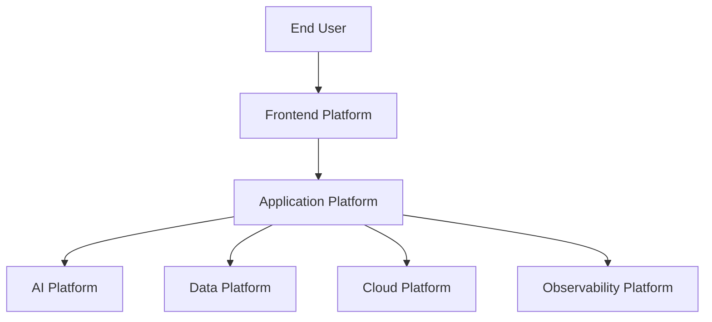

# Enterprise Architecture

> Enterprise-grade reference architecture for building, deploying, operating and scaling modern AI applications across AWS, Azure, GCP and Vercel.

---

# Purpose

The AI Cloud MLOps Platform is a reference architecture designed to demonstrate how modern AI systems can be delivered in production environments.

The platform combines:

- SaaS Applications
- AI Agents
- Retrieval-Augmented Generation (RAG)
- Model Context Protocol (MCP)
- Multi-Agent Systems
- MLOps
- Infrastructure as Code
- Observability
- Security Engineering
- Multi-Cloud Operations

The objective is to provide a reusable architectural foundation for enterprise AI solutions.

---

# Vision

Create a production-grade AI platform capable of:

- Deploying scalable SaaS products
- Running AI agents in production
- Integrating enterprise knowledge through RAG
- Orchestrating external tools through MCP
- Supporting multiple AI providers
- Operating across multiple cloud providers
- Maintaining enterprise-level security and observability

---

# Business Objectives

## Operational Excellence

- Standardized platform
- Reduced deployment complexity
- Automated operations

## Developer Experience

- Faster onboarding
- Reusable architecture
- Shared services

## Enterprise Readiness

- Security controls
- Auditability
- Scalability
- Reliability

---

# High-Level Architecture

The architecture is intentionally simplified.

Each platform represents a strategic capability that is described in dedicated architecture documents.

---

# Platform Domains

## Frontend Platform

Responsibilities:

- User Experience
- Authentication Experience
- Subscription Experience
- Dashboards
- SaaS Interfaces

Technology Stack:

- Next.js
- TypeScript
- Clerk

---

## Application Platform

Responsibilities:

- Business Logic
- APIs
- Service Orchestration
- Request Routing
- Workflow Coordination

Technology Stack:

- FastAPI
- Python

---

## AI Platform

Responsibilities:

- Agent Execution
- RAG Processing
- MCP Integration
- Model Routing
- Prompt Management

Technology Stack:

- Bedrock
- OpenAI
- Claude
- LangGraph
- MCP

---

## Data Platform

Responsibilities:

- Transactional Data
- Knowledge Storage
- Vector Search
- Caching

Technology Stack:

- Aurora Serverless
- Redis
- Amazon S3
- Vector Database

---

## Cloud Platform

Responsibilities:

- Infrastructure
- Networking
- Compute
- Storage
- Deployment

Technology Stack:

- AWS
- Azure
- GCP
- Terraform

---

## Observability Platform

Responsibilities:

- Monitoring
- Tracing
- Logging
- Cost Visibility

Technology Stack:

- LangFuse
- CloudWatch
- Grafana
- Prometheus

---

# Architecture Principles

## API First

All business capabilities are exposed through APIs.

## Infrastructure as Code

All infrastructure is managed through Terraform.

## Security by Design

Security controls are integrated into every layer.

## Observability First

Logs, metrics and traces are treated as first-class citizens.

## Modular Architecture

Components must remain loosely coupled.

## Vendor Abstraction

AI providers must remain interchangeable whenever possible.

---

# Responsibility Matrix

| Domain | Primary Responsibility |
|----------|----------|
| Frontend Platform | User Experience & Authentication |
| Application Platform | API Services & Business Logic |
| AI Platform | Agents, RAG, MCP and LLM Integration |
| Data Platform | Storage, Retrieval and Caching |
| Cloud Platform | Infrastructure and Deployment |
| Observability Platform | Monitoring, Logging and Tracing |
| Security Platform | Access Control and Governance |

---

# Reference Architecture Documents

The detailed architecture is split into specialized documents.

| Document | Purpose |
|-----------|-----------|
| application-architecture.md | Application components and services |
| cloud-architecture.md | Multi-cloud deployment strategy |
| data-architecture.md | Data flows and storage architecture |
| security-architecture.md | Security controls and governance |
| deployment-architecture.md | CI/CD and environment promotion |

---

# Related Architecture Decision Records

- ADR-001 Multi-Cloud Strategy
- ADR-002 Vector Database Strategy
- ADR-003 Agent Framework
- ADR-004 Observability Strategy
- ADR-005 Monorepo Strategy
- ADR-006 Model Gateway
- ADR-007 RAG Platform
- ADR-008 Security by Design
- ADR-009 Infrastructure as Code

---

# Non-Functional Requirements

## Availability

Target availability: 99.9%

## Scalability

Horizontal scaling across all stateless services.

## Security

- JWT Authentication
- IAM Authorization
- Secret Management
- Encryption in Transit
- Encryption at Rest

## Observability

Every service must provide:

- Logs
- Metrics
- Traces

## Maintainability

All major architectural decisions must be documented and version controlled.

---

# Target State

The platform evolves toward a fully integrated enterprise AI ecosystem that combines:

- SaaS Products
- AI Agents
- RAG Systems
- MCP Integrations
- MLOps Pipelines
- Multi-Agent Architectures
- Enterprise Security
- Cloud-Native Operations

under a single, coherent and reusable platform architecture.