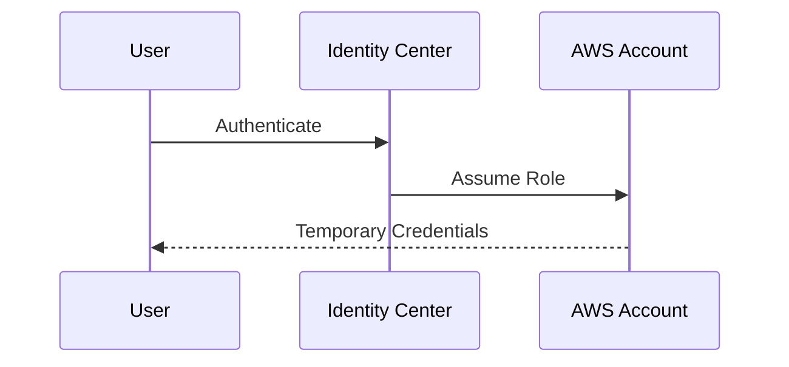
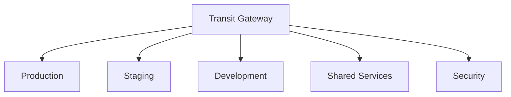
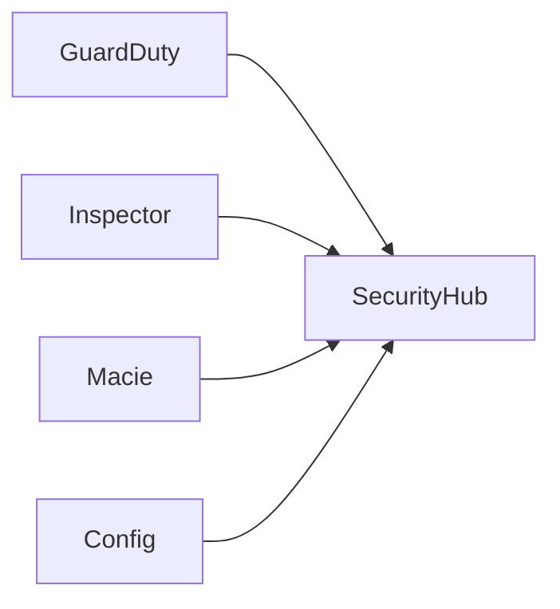
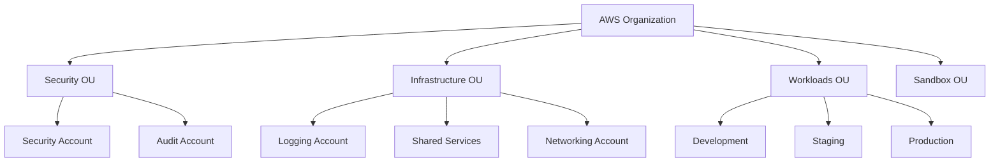

# Landing Zone Architecture

> Enterprise AWS Landing Zone Architecture for the AI Cloud MLOps Platform, providing governance, security, networking, identity management, compliance, observability, and multi-account foundations for scalable AI workloads.

---

# Table of Contents

- Overview
- Objectives
- Guiding Principles
- Landing Zone Architecture
- AWS Organization Structure
- Organizational Units
- Account Structure
- Identity Architecture
- Governance Architecture
- Network Architecture
- Security Architecture
- Logging & Audit Architecture
- Shared Services Architecture
- Infrastructure Standards
- Environment Strategy
- Multi-Region Strategy
- Disaster Recovery
- Compliance Architecture
- FinOps Architecture
- Platform Services
- Account Responsibility Matrix
- Landing Zone Deployment Process
- Future Evolution
- Enterprise Diagram

---

# Overview

The Landing Zone provides the foundational cloud environment upon which all platform workloads are deployed.

It establishes:

- Governance
- Security
- Identity
- Compliance
- Networking
- Cost Management
- Monitoring
- Automation

The Landing Zone serves as the enterprise control plane for all AWS environments.

---

# Objectives

## Security

Provide secure-by-default cloud foundations.

## Governance

Enable centralized policy enforcement.

## Scalability

Support growth from a small platform to enterprise-scale deployments.

## Compliance

Support:

- GDPR
- ISO 27001
- SOC 2
- NIST CSF

## Operational Excellence

Provide repeatable, automated cloud operations.

---

# Guiding Principles

## Multi-Account First

Isolation is achieved through account boundaries.

## Infrastructure as Code

All resources are deployed using Terraform.

## Least Privilege

All permissions follow minimum required access.

## Security By Default

No resource should be exposed without explicit approval.

## Auditability

Every action must be traceable.

## Automation First

Manual operations should be minimized.

---

# Landing Zone Architecture

```text
AWS Organization
│
├── Security OU
├── Infrastructure OU
├── Workloads OU
└── Sandbox OU
```

The Landing Zone is managed centrally and serves all environments.

---

# AWS Organization Structure

## Organization Components

```text
AWS Organization

├── Root
│
├── Security OU
│
├── Infrastructure OU
│
├── Workloads OU
│
└── Sandbox OU
```

---

## Root Account

Responsibilities:

- Billing Management
- Organization Management
- SCP Administration

Strict controls are applied.

No workloads are deployed here.

---

# Organizational Units

## Security OU

Contains security-focused accounts.

```text
Security OU

├── Security Account
└── Audit Account
```

Responsibilities:

- Security Hub
- GuardDuty
- IAM Governance
- Compliance Monitoring

---

## Infrastructure OU

Contains shared infrastructure.

```text
Infrastructure OU

├── Logging Account
├── Shared Services Account
└── Networking Account
```

Responsibilities:

- Central Logging
- DNS
- Transit Gateway
- Shared Kubernetes Services

---

## Workloads OU

Contains platform environments.

```text
Workloads OU

├── Development
├── Staging
└── Production
```

Responsibilities:

- Business Workloads
- AI Services
- Platform Services

---

## Sandbox OU

Used for experimentation.

```text
Sandbox OU

├── Individual Projects
├── POCs
└── Training
```

Strict spending controls apply.

---

# Account Structure

## Security Account

Purpose:

Centralizes security operations.

Services:

- Security Hub
- GuardDuty
- Inspector
- Macie
- IAM Access Analyzer

---

## Audit Account

Purpose:

Compliance oversight.

Services:

- CloudTrail Aggregation
- Compliance Reporting
- Forensic Data Storage

---

## Logging Account

Purpose:

Centralized observability.

Services:

- CloudTrail
- CloudWatch Logs
- VPC Flow Logs
- OpenSearch

---

## Shared Services Account

Purpose:

Shared platform services.

Services:

- Identity Federation
- Artifact Repositories
- Central Secrets
- Shared APIs

---

## Networking Account

Purpose:

Centralized network operations.

Services:

- Transit Gateway
- Route53
- Shared Connectivity
- VPN

---

## Development Account

Purpose:

Developer workloads.

Characteristics:

- Lower security restrictions
- Cost controls
- Automated cleanup

---

## Staging Account

Purpose:

Pre-production validation.

Characteristics:

- Production-like configuration
- Release testing

---

## Production Account

Purpose:

Customer-facing workloads.

Characteristics:

- Highest security
- Strict governance
- Change control

---

# Identity Architecture

## Identity Strategy

The Landing Zone uses centralized identity.

---

## AWS IAM Identity Center

Primary capabilities:

- SSO
- Federation
- Role Assignment
- Centralized Identity

---

## Identity Sources

```text
Microsoft Entra ID
Google Workspace
Corporate Directory
```

---

## Access Flow



---

## Role Strategy

### Administrator

Platform administration.

### Security Administrator

Security operations.

### Developer

Application delivery.

### ReadOnly

Audit and reporting.

---

# Governance Architecture

Governance is enforced using:

- SCPs
- Tag Policies
- Config Rules
- Security Policies

---

## Service Control Policies

Examples:

### Deny Root Usage

```text
No Root Access
```

### Restrict Unsupported Regions

```text
Allow Approved Regions Only
```

### Prevent Public Resources

```text
No Public S3 Buckets
```

---

## Tagging Standards

Mandatory tags:

```text
Application

Environment

CostCenter

Owner

DataClassification

ManagedBy
```

---

# Network Architecture

The Landing Zone provides shared networking constructs.

---

## Networking Components

```text
Transit Gateway

Shared DNS

Private Connectivity

Inspection Layer
```

---

## Hub-and-Spoke Topology



---

## Private Connectivity

Supported:

- Site-to-Site VPN
- Direct Connect
- PrivateLink
- VPC Peering

---

# Security Architecture

Security services are centralized.

---

## Core Services

### GuardDuty

Threat detection.

### Security Hub

Central findings.

### Inspector

Vulnerability assessment.

### Macie

Sensitive data discovery.

### IAM Access Analyzer

Permission analysis.

---

## Security Aggregation



---

# Logging & Audit Architecture

## Logging Sources

- CloudTrail
- VPC Flow Logs
- Route53 Logs
- Security Events
- Application Logs

---

## Log Destination

```text
Logging Account
```

---

## Retention Strategy

| Data Type | Retention |
|------------|------------|
| Audit Logs | 7 Years |
| Security Logs | 3 Years |
| Application Logs | 1 Year |
| Metrics | 15 Months |

---

# Shared Services Architecture

The Shared Services Account hosts reusable platform services.

---

## Services

- Artifact Registry
- Shared DNS
- GitHub OIDC
- Secrets Replication
- Monitoring

---

## Platform Services

```text
ECR

OpenTelemetry

GitHub OIDC

Shared APIs
```

---

# Infrastructure Standards

## Approved Regions

```text
eu-west-1

eu-central-1
```

---

## Approved Services

Use approved cloud services only.

Architectural reviews are required for exceptions.

---

# Environment Strategy

## Development

Purpose:

Engineering and experimentation.

---

## Staging

Purpose:

Validation.

---

## Production

Purpose:

Business operations.

---

## Environment Isolation

Each environment resides in a dedicated AWS account.

---

# Multi-Region Strategy

## Primary Region

```text
eu-west-1
```

---

## Secondary Region

```text
eu-central-1
```

---

## Replicated Services

- S3
- Backups
- Container Images
- Critical Databases

---

# Disaster Recovery

## Recovery Strategy

| Service | RTO | RPO |
|----------|----------|----------|
| Platform APIs | 1 Hour | 15 Minutes |
| Databases | 1 Hour | 15 Minutes |
| Object Storage | 4 Hours | Near Zero |
| Monitoring | 4 Hours | 30 Minutes |

---

# Compliance Architecture

Supported standards:

- GDPR
- ISO 27001
- NIST
- SOC 2

---

## Compliance Controls

- Encryption
- Audit Logging
- IAM Governance
- Continuous Monitoring
- Backup Management

---

# FinOps Architecture

Cost governance is centralized.

---

## Cost Controls

- Tagging Policies
- Budget Alerts
- Cost Allocation
- Chargeback
- Showback

---

## Cost Visibility

Reports generated by:

- AWS Cost Explorer
- CUR
- QuickSight

---

# Platform Services

## AI Platform

- Bedrock
- RAG
- Agents
- MCP

---

## Cloud Platform

- EKS
- Terraform
- GitHub Actions

---

## Operations Platform

- Grafana
- Prometheus
- CloudWatch

---

# Account Responsibility Matrix

| Account | Purpose |
|----------|----------|
| Root | Organization Management |
| Security | Security Services |
| Audit | Compliance |
| Logging | Central Logging |
| Shared Services | Platform Services |
| Networking | Network Services |
| Development | Engineering |
| Staging | Validation |
| Production | Operations |

---

# Landing Zone Deployment Process

## Phase 1

AWS Organization

---

## Phase 2

Identity Center

---

## Phase 3

Security Controls

---

## Phase 4

Networking

---

## Phase 5

Logging

---

## Phase 6

Shared Services

---

## Phase 7

Workload Accounts

---

## Phase 8

Platform Deployment

---

# Future Evolution

## Short Term

- Full Terraform Automation
- Control Tower Integration
- Security Baselines

---

## Medium Term

- Multi-Region Failover
- Cloud WAN
- Landing Zone Accelerator

---

## Long Term

- Multi-Cloud Landing Zone
- Zero Trust Everywhere
- Policy-as-Code Governance

---

# Enterprise Landing Zone Diagram



---

# Conclusion

The Landing Zone Architecture establishes the governance, security, networking, compliance, and operational foundations of the