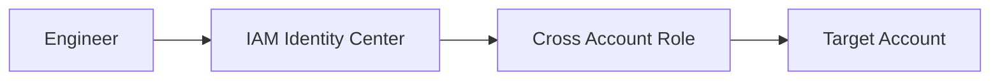
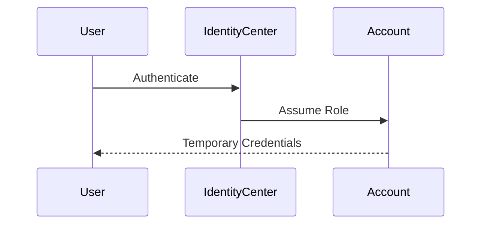
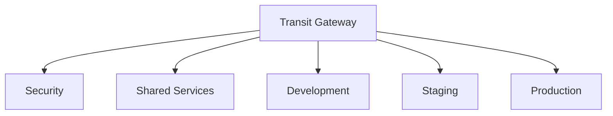
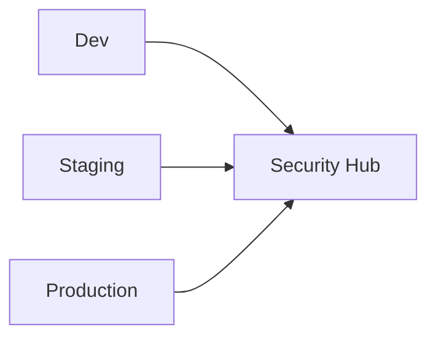
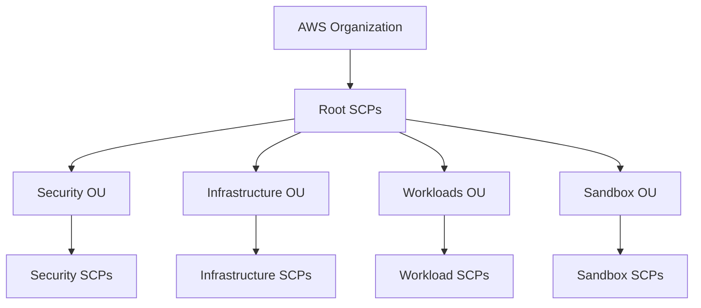
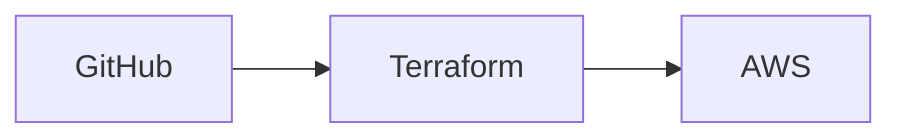
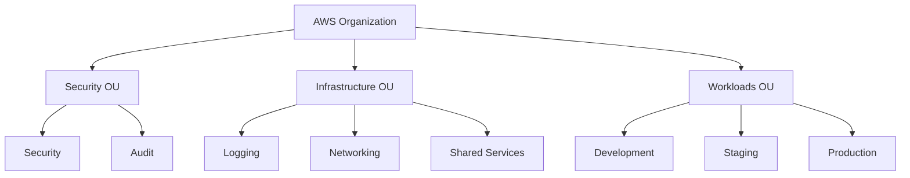

# Multi-Account Architecture

> Enterprise Multi-Account Architecture for the AI Cloud MLOps Platform, providing security isolation, operational separation, governance, compliance, cost management, and scalable cloud operations across all environments.

---

# Table of Contents

- Overview
- Objectives
- Architecture Principles
- Multi-Account Strategy
- Account Hierarchy
- Organizational Unit Design
- Account Types
- Security Model
- Cross-Account Access
- Identity Federation
- Network Connectivity
- Centralized Security
- Centralized Logging
- Centralized Monitoring
- Data Governance
- Infrastructure Governance
- Terraform Strategy
- CI/CD Architecture
- Cost Governance
- Compliance Architecture
- Multi-Region Architecture
- Disaster Recovery
- Service Ownership Model
- Responsibility Matrix
- Deployment Strategy
- Future Evolution
- Enterprise Diagrams

---

# Overview

The platform adopts a multi-account architecture to achieve:

- Security isolation
- Blast radius reduction
- Governance enforcement
- Environment separation
- Financial accountability
- Regulatory compliance
- Centralized operations

AWS accounts are considered the primary security boundary.

This architecture follows recommendations from:

- AWS Well-Architected Framework
- AWS Security Reference Architecture
- AWS Control Tower
- Landing Zone Accelerator
- NIST Cybersecurity Framework

---

# Objectives

## Security Isolation

Separate critical workloads through account boundaries.

## Independent Environments

Prevent development activities from impacting production.

## Governance

Apply enterprise controls consistently.

## Compliance

Facilitate audit and regulatory requirements.

## Cost Visibility

Enable accurate cost attribution and chargeback.

## Scalability

Support future teams, workloads and business domains.

---

# Architecture Principles

## Account as Security Boundary

AWS accounts provide the strongest isolation mechanism.

---

## Least Privilege

Access is granted only when required.

---

## Centralized Governance

Governance policies are defined centrally.

---

## Decentralized Operations

Application teams own their workloads.

---

## Immutable Infrastructure

Environment changes occur through Infrastructure as Code.

---

## Auditability

Every action must be traceable.

---

# Multi-Account Strategy

The platform separates infrastructure into dedicated accounts based on responsibility and risk profile.

## High-Level Structure

```text
AWS Organization
│
├── Security OU
├── Infrastructure OU
├── Workloads OU
└── Sandbox OU
```

---

# Account Hierarchy

```text
AWS Organization
│
├── Security OU
│   ├── Security Account
│   └── Audit Account
│
├── Infrastructure OU
│   ├── Logging Account
│   ├── Shared Services Account
│   └── Networking Account
│
├── Workloads OU
│   ├── Development Account
│   ├── Staging Account
│   └── Production Account
│
└── Sandbox OU
    └── Sandbox Account
```

---

# Organizational Unit Design

## Security OU

Dedicated to security operations.

Responsibilities:

- Threat Detection
- Vulnerability Management
- Compliance Monitoring
- Security Reporting

---

## Infrastructure OU

Provides shared platform services.

Responsibilities:

- Networking
- DNS
- Shared Platform Components
- Artifact Repositories

---

## Workloads OU

Hosts business and platform workloads.

Responsibilities:

- APIs
- Agents
- MCP Services
- RAG Systems
- AI Applications

---

## Sandbox OU

Experimentation and learning.

Restrictions:

- Budget Limits
- Automatic Cleanup
- Non-Production Data Only

---

# Account Types

## Root Account

Purpose:

Organization management.

Restrictions:

- No workloads
- No user activity
- MFA mandatory
- Break-glass usage only

---

## Security Account

Purpose:

Central security operations.

Services:

- Security Hub
- GuardDuty
- Inspector
- Macie
- Access Analyzer

---

## Audit Account

Purpose:

Audit and forensic analysis.

Services:

- CloudTrail Archive
- Compliance Reporting
- Security Data Storage

---

## Logging Account

Purpose:

Centralized observability.

Services:

- CloudTrail
- VPC Flow Logs
- OpenSearch
- Long-Term Retention

---

## Networking Account

Purpose:

Shared enterprise networking.

Services:

- Transit Gateway
- Route53
- VPN
- Direct Connect

---

## Shared Services Account

Purpose:

Reusable platform capabilities.

Services:

- GitHub OIDC
- Container Registries
- Shared DNS
- Shared APIs
- Certificate Management

---

## Development Account

Purpose:

Engineering activities.

Characteristics:

- Lower restrictions
- Frequent deployments
- Cost-controlled

---

## Staging Account

Purpose:

Production validation.

Characteristics:

- Production-like configuration
- Integration testing
- Performance testing

---

## Production Account

Purpose:

Business workloads.

Characteristics:

- Highest security standards
- Change controls
- Full monitoring
- Compliance controls

---

# Security Model

## Security Domain Ownership

```text
Security Account
          │
          ▼
All AWS Accounts
```

Security controls are enforced centrally.

---

## Security Segregation

| Control | Centralized |
|----------|----------|
| Security Hub | Yes |
| GuardDuty | Yes |
| Inspector | Yes |
| IAM Standards | Yes |
| CloudTrail | Yes |

---

# Cross-Account Access

Access between accounts is controlled through IAM Roles.

---

## Access Pattern



---

## Cross-Account Principles

- No shared credentials
- Temporary credentials only
- MFA enforced
- Auditable access paths

---

# Identity Federation

## Central Identity

Authentication is centralized using:

- Microsoft Entra ID
- OIDC Providers
- AWS IAM Identity Center

---

## Access Flow



---

# Network Connectivity

## Hub-and-Spoke Network Model



---

## Connectivity Options

Supported:

- Transit Gateway
- VPC Peering
- PrivateLink
- Site-to-Site VPN
- Direct Connect

---

# Centralized Security

## Security Hub

Aggregates findings from all accounts.

---

## GuardDuty

Detects threats organization-wide.

---

## Inspector

Performs centralized vulnerability scanning.

---

## Macie

Scans for sensitive information.

---

## Config

Tracks configuration compliance.

---

# Security Aggregation Architecture



---

# Centralized Logging

All logs are aggregated into the Logging Account.

## Log Sources

- CloudTrail
- VPC Flow Logs
- ALB Logs
- WAF Logs
- Security Events
- EKS Logs

---

## Benefits

- Long-term retention
- Compliance
- Forensics
- Central search

---

# Centralized Monitoring

Observability data is collected centrally.

## Monitoring Stack

- CloudWatch
- Grafana
- Prometheus
- OpenTelemetry
- LangFuse

---

# Data Governance

Data is classified according to sensitivity.

## Data Classification

| Level | Description |
|---------|---------|
| Public | Unrestricted |
| Internal | Internal Usage |
| Confidential | Restricted |
| Highly Confidential | Highly Restricted |

---

## Controls

- Encryption
- Retention Policies
- Access Controls
- Audit Logging

---

# Infrastructure Governance

## Service Control Policies

Examples:

### Deny Public S3

```text
No Public Buckets
```

---

### Restrict Regions

```text
Approved Regions Only
```

---

### Enforce Encryption

```text
Encryption Required
```

---


# Service Control Policy (SCP) Matrix

Service Control Policies (SCPs) establish mandatory guardrails across all AWS accounts.

These policies do not grant permissions.

They define the maximum permissions that can be granted within an account.

---

# SCP Architecture



---

# SCP Control Matrix

| SCP Policy | Security | Infrastructure | Development | Staging | Production | Sandbox |
|------------|----------|----------|----------|----------|----------|----------|
| Deny Root Usage | ✅ | ✅ | ✅ | ✅ | ✅ | ✅ |
| Require MFA | ✅ | ✅ | ✅ | ✅ | ✅ | ✅ |
| Restrict AWS Regions | ✅ | ✅ | ✅ | ✅ | ✅ | ✅ |
| Deny Public S3 Buckets | ✅ | ✅ | ✅ | ✅ | ✅ | ✅ |
| Require Encryption | ✅ | ✅ | ✅ | ✅ | ✅ | ✅ |
| Restrict IAM User Creation | ✅ | ✅ | ✅ | ✅ | ✅ | ✅ |
| Restrict Security Group Changes | ✅ | ✅ | ⚠️ | ⚠️ | ✅ | ❌ |
| Restrict CloudTrail Modification | ✅ | ✅ | ✅ | ✅ | ✅ | ✅ |
| Restrict GuardDuty Modification | ✅ | ✅ | ✅ | ✅ | ✅ | ✅ |
| Restrict Security Hub Modification | ✅ | ✅ | ✅ | ✅ | ✅ | ✅ |
| Deny KMS Key Deletion | ✅ | ✅ | ✅ | ✅ | ✅ | ✅ |
| Restrict Internet Gateways | ❌ | ✅ | ⚠️ | ⚠️ | ✅ | ❌ |
| Restrict Route Table Changes | ❌ | ✅ | ⚠️ | ⚠️ | ✅ | ❌ |
| Restrict Transit Gateway Changes | ❌ | ✅ | ❌ | ❌ | ✅ | ❌ |
| Restrict Bedrock Model Access | ❌ | ❌ | ⚠️ | ✅ | ✅ | ❌ |
| Restrict Marketplace Purchases | ✅ | ✅ | ✅ | ✅ | ✅ | ✅ |
| Restrict Unsupported Services | ✅ | ✅ | ✅ | ✅ | ✅ | ✅ |
| Restrict Account Closure | ✅ | ✅ | ✅ | ✅ | ✅ | ✅ |

Legend:

- ✅ Enforced
- ⚠️ Conditional
- ❌ Not Applied

---

# Core Organization SCPs

These policies apply to all accounts.

---

## SCP-001 Deny Root Usage

Purpose:

Prevent day-to-day use of the root account.

Controls:

```text
Deny all actions except
break-glass recovery procedures.
```

Risk Mitigated:

- Privilege misuse
- Credential compromise

---

## SCP-002 Require MFA

Purpose:

Ensure privileged access requires MFA.

Protected Resources:

- IAM
- Billing
- Security Services
- Production Accounts

---

## SCP-003 Approved Regions Only

Purpose:

Restrict deployments to approved regions.

Allowed Regions:

```text
eu-west-1
eu-central-1
```

Benefits:

- Compliance
- Cost Control
- Governance

---

## SCP-004 Deny Public S3 Buckets

Purpose:

Prevent accidental data exposure.

Blocked Actions:

```text
PutBucketPublicAccessBlock = false

Public ACLs

Public Policies
```

---

## SCP-005 Encryption Enforcement

Purpose:

Ensure encryption is mandatory.

Protected Services:

- S3
- EBS
- Aurora
- OpenSearch
- Backups

---

# Security OU SCPs

The Security OU enforces stricter controls.

---

## SCP-101 Protect Security Hub

Purpose:

Prevent disabling centralized security findings.

---

## SCP-102 Protect GuardDuty

Purpose:

Prevent disabling threat detection.

---

## SCP-103 Protect Config

Purpose:

Prevent disabling compliance monitoring.

---

## SCP-104 Protect CloudTrail

Purpose:

Prevent audit log tampering.

---

## SCP-105 Protect Access Analyzer

Purpose:

Protect permission visibility.

---

# Infrastructure OU SCPs

---

## SCP-201 Network Governance

Restrict:

- Route Tables
- Internet Gateways
- Transit Gateway
- VPC Sharing

Only platform administrators may modify.

---

## SCP-202 DNS Governance

Restrict modifications to:

- Route53 Public Zones
- Shared Private Zones

---

## SCP-203 Shared Services Protection

Protect:

- ECR
- Shared APIs
- Shared DNS
- Identity Services

---

# Workloads OU SCPs

---

## SCP-301 Bedrock Governance

Restrict model usage to approved foundation models.

Approved Providers:

```text
Anthropic
OpenAI
AWS Titan
```

---

## SCP-302 Resource Tagging Enforcement

Mandatory Tags:

```text
Application
Environment
Owner
CostCenter
DataClassification
ManagedBy
```

Non-compliant resources are denied.

---

## SCP-303 Production Change Controls

Restrict:

- Production deletion
- Infrastructure destruction
- Critical resource modification

Without approved deployment workflows.

---

# Sandbox OU SCPs

Sandbox accounts intentionally have fewer restrictions but stronger spending controls.

---

## SCP-401 Budget Protection

Budget Thresholds:

```text
Monthly Limits

Automatic Notifications

Automated Cleanup
```

---

## SCP-402 Resource Lifetime Controls

Ephemeral resources are automatically removed.

Examples:

```text
Unused EC2

Temporary Databases

Test Clusters
```

---

## SCP-403 Marketplace Restrictions

Prevent unauthorized purchases.

---

# SCP Compliance Matrix

| Requirement | SCP Coverage |
|-------------|-------------|
| GDPR | Encryption + Logging |
| ISO 27001 | Access Control + Audit |
| SOC 2 | Monitoring + Security Controls |
| NIST | Prevent + Detect + Respond |
| CIS Benchmarks | Governance Enforcement |

---

# SCP Lifecycle Management

## Policy Design

Security and Platform Engineering collaborate.

---

## Policy Review

Frequency:

```text
Quarterly
```

---

## Policy Testing

Environment:

```text
Sandbox
Development
```

Before promotion.

---

## Policy Deployment

```text
Sandbox
    ↓
Development
    ↓
Staging
    ↓
Production
```

---

# Future SCP Enhancements

## Short-Term

- Tag Enforcement
- Bedrock Governance
- Cost Controls

---

## Mid-Term

- Policy as Code
- Automated Compliance
- AI Governance SCPs

---

## Long-Term

- Multi-Cloud Governance
- Unified Enterprise Policies
- Autonomous Compliance Validation

---


# Terraform Strategy

All infrastructure is provisioned through Terraform.

---

## Repository Structure

```text
infrastructure/

├── landing-zone/
├── networking/
├── security/
├── observability/
├── shared-services/
└── workloads/
```

---

## Deployment Model

```text
Terraform
    ↓
AWS Organization
    ↓
Accounts
    ↓
Resources
```

---

# CI/CD Architecture

Infrastructure deployment is automated.



---

# Cost Governance

Costs are tracked by account.

---

## Chargeback Strategy

| Account | Billing Owner |
|----------|----------|
| Development | Engineering |
| Staging | Platform Team |
| Production | Product Owner |

---

## Tag Requirements

Mandatory:

```text
Application
Environment
Owner
CostCenter
ManagedBy
```

---

# Compliance Architecture

Supported frameworks:

- ISO 27001
- GDPR
- SOC 2
- NIST

---

## Compliance Controls

- Encryption
- Audit Logging
- IAM Governance
- Monitoring
- Backup Policies

---

# Multi-Region Architecture

## Primary Region

```text
eu-west-1
```

---

## Secondary Region

```text
eu-central-1
```

---

## Account Replication Strategy

Critical accounts maintain:

- Backup Replication
- Image Replication
- Log Replication
- Secrets Replication

---

# Disaster Recovery

## Recovery Objectives

| Service | RPO | RTO |
|----------|----------|----------|
| Identity | 15 min | 1 h |
| Logging | 30 min | 2 h |
| Networking | 1 h | 2 h |
| Production Workloads | 15 min | 1 h |

---

# Service Ownership Model

## Security Team

Owns:

- Security Services
- Compliance
- Incident Response

---

## Platform Team

Owns:

- Networking
- Shared Services
- Landing Zone

---

## Application Teams

Own:

- APIs
- Agents
- Applications

---

# Responsibility Matrix

| Account | Owner |
|----------|----------|
| Root | Cloud Governance |
| Security | Security Team |
| Audit | Security Team |
| Logging | Platform Team |
| Networking | Platform Team |
| Shared Services | Platform Team |
| Development | Engineering |
| Staging | Engineering |
| Production | Platform + Product |

---

# Deployment Strategy

## Phase 1

Organization Setup

---

## Phase 2

Identity Federation

---

## Phase 3

Security Baseline

---

## Phase 4

Networking

---

## Phase 5

Logging

---

## Phase 6

Shared Services

---

## Phase 7

Environment Accounts

---

## Phase 8

Platform Deployment

---

# Future Evolution

## Near Term

- Control Tower
- Landing Zone Accelerator
- Security Baselines

---

## Mid Term

- Cloud WAN
- Multi-Region Operations
- Automated Compliance

---

## Long Term

- Multi-Cloud Governance
- Unified Identity
- Global Control Plane

---

# Enterprise Multi-Account Diagram



---

# Conclusion

The Multi-Account Architecture establishes the operational foundation required to run enterprise-grade AI workloads securely and at scale.

By combining strong account isolation, centralized governance, federated identity, shared services, and automated controls, the platform achieves security, scalability, compliance, and operational excellence while minimizing risk and supporting future growth.