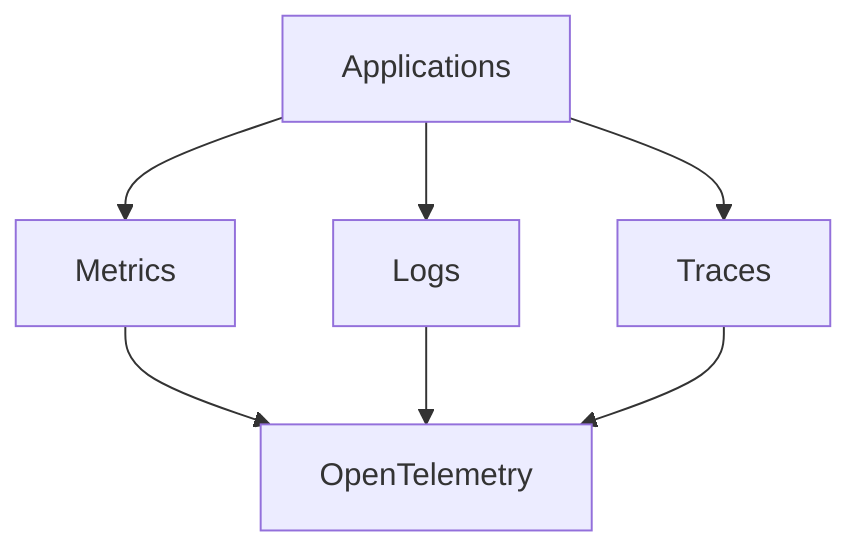
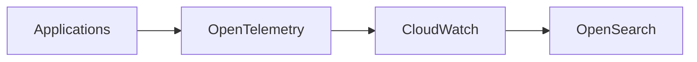
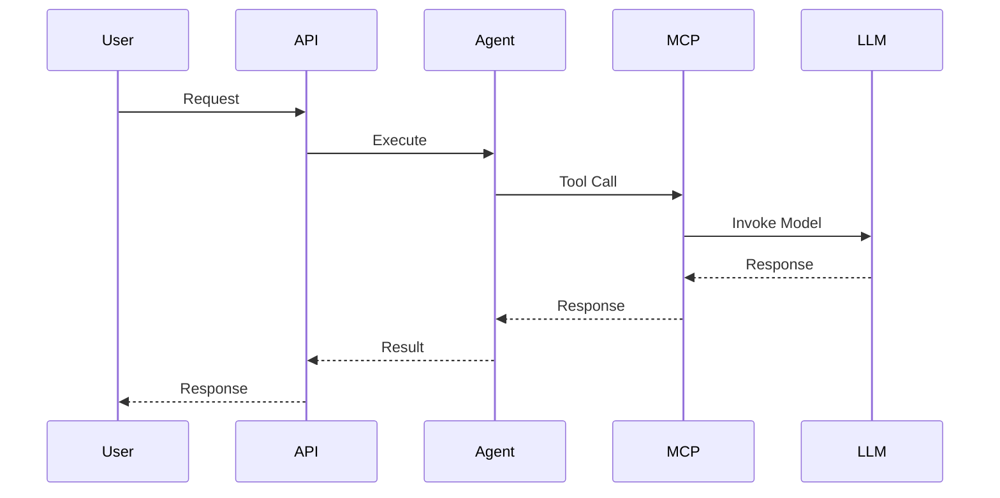
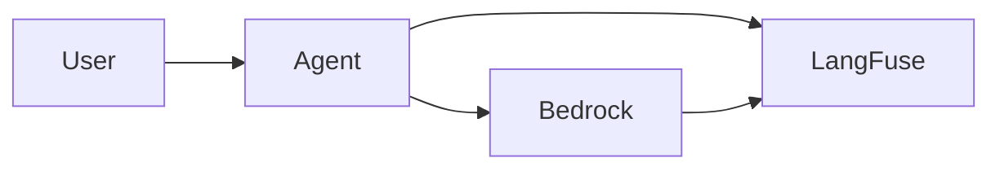
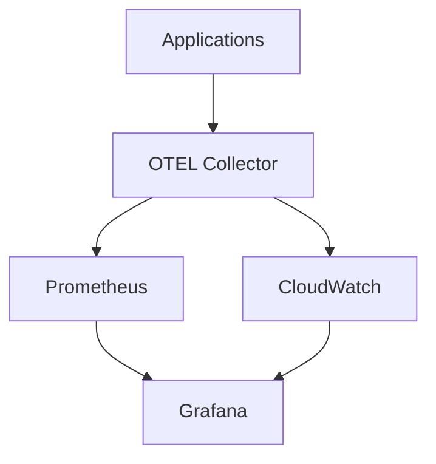
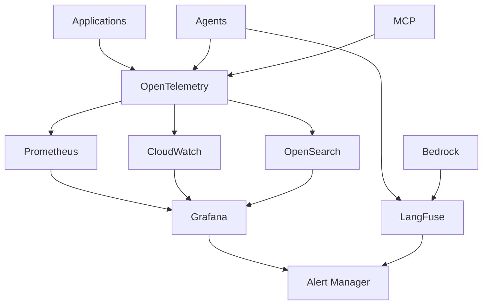

# Observability Architecture

> Enterprise Observability Architecture for the AI Cloud MLOps Platform, providing end-to-end visibility across infrastructure, applications, AI systems, agents, MCP integrations, cloud services, and operational workflows.

---

# Table of Contents

- Overview
- Objectives
- Observability Principles
- Architecture Overview
- Observability Domains
- Telemetry Strategy
- Metrics Architecture
- Logging Architecture
- Distributed Tracing
- AI Observability
- Agent Observability
- MCP Observability
- Infrastructure Observability
- OpenTelemetry Architecture
- Monitoring Stack
- Centralized Monitoring
- Dashboards
- Alerting Strategy
- SLI, SLO and SLA Framework
- Error Budget Management
- Observability Maturity Model
- Compliance & Auditability
- Cost Optimization
- Responsibility Matrix
- Enterprise Diagrams
- Future Enhancements

---

# Overview

Observability provides the ability to understand the internal state of a system by analyzing telemetry data.

The platform uses observability to:

- Detect failures
- Troubleshoot incidents
- Measure reliability
- Optimize performance
- Improve user experience
- Govern AI systems
- Reduce Mean Time To Resolution (MTTR)

Observability is a first-class architectural requirement.

---

# Objectives

## Reliability

Detect and resolve service degradation rapidly.

---

## Visibility

Provide end-to-end system visibility.

---

## Performance

Measure and optimize platform performance.

---

## Security

Detect anomalous behavior and suspicious activities.

---

## Governance

Support compliance and audit requirements.

---

## AI Monitoring

Observe AI workloads and model behavior.

---

# Observability Principles

## Observability by Design

All services must emit telemetry.

---

## Standardization

Use OpenTelemetry as the telemetry standard.

---

## Centralization

Observability data is aggregated centrally.

---

## Correlation

Logs, traces and metrics must be correlated.

---

## Automation

Alerting and remediation should be automated whenever possible.

---

## Continuous Improvement

Observability evolves with the platform.

---

# Architecture Overview

The platform follows a layered observability model.

```text
Application Layer
        ↓
Telemetry Layer
        ↓
Collection Layer
        ↓
Storage Layer
        ↓
Visualization Layer
        ↓
Alerting Layer
```

---

# Observability Domains

| Domain | Scope |
|----------|----------|
| Infrastructure | AWS, Kubernetes, Network |
| Application | APIs, Services |
| Platform | CI/CD, GitOps |
| AI | LLMs, Agents, RAG |
| Security | Audit Events |
| Business | Product KPIs |

---

# Telemetry Strategy

The platform collects three primary telemetry signals.

---

## Metrics

Numerical measurements over time.

Examples:

- CPU Usage
- Memory Usage
- Request Rate
- Error Rate

---

## Logs

Event records.

Examples:

- Application Logs
- Audit Logs
- Security Events

---

## Traces

Distributed request tracking.

Examples:

- API Request Flow
- Agent Execution Flow
- RAG Retrieval Chains

---

# Telemetry Architecture



---

# Metrics Architecture

Metrics are collected continuously.

---

## Infrastructure Metrics

Examples:

- CPU Utilization
- Memory Utilization
- Network Throughput
- Disk IOPS

---

## Kubernetes Metrics

Examples:

- Pod Status
- Node Health
- Replica Count
- Resource Consumption

---

## Application Metrics

Examples:

- API Latency
- Request Rate
- Error Rate
- Queue Length

---

## AI Metrics

Examples:

- Prompt Volume
- Model Latency
- Token Usage
- Model Errors

---

# Golden Signals

The platform follows Google's Golden Signals methodology.

| Signal | Description |
|----------|----------|
| Latency | Request Duration |
| Traffic | Load Volume |
| Errors | Failed Requests |
| Saturation | Resource Exhaustion |

---

# Logging Architecture

Centralized logging provides platform-wide visibility.

---

## Log Categories

### Application Logs

Generated by APIs and services.

---

### Audit Logs

Generated by security-sensitive activities.

---

### Infrastructure Logs

Generated by AWS resources.

---

### AI Logs

Generated by model interactions.

---

## Logging Flow



---

# Distributed Tracing

Tracing enables request correlation across services.

---

## Tracing Goals

- Identify bottlenecks
- Detect failures
- Optimize performance
- Correlate logs

---

## Trace Flow



---

# AI Observability

AI workloads require additional controls beyond traditional applications.

---

## AI Monitoring Domains

- Prompt Monitoring
- Completion Monitoring
- Token Monitoring
- Model Performance
- Hallucination Analysis
- Safety Controls

---

## AI Monitoring Metrics

| Metric | Description |
|----------|----------|
| Prompt Count | Requests |
| Completion Count | Responses |
| Token Usage | Consumption |
| Latency | Response Time |
| Failure Rate | Errors |
| Cost Per Request | Economics |

---

# LangFuse Architecture

LangFuse provides AI observability.

---

## Capabilities

- Prompt Tracking
- Trace Visualization
- Cost Analysis
- Evaluation
- Experiment Tracking

---

## AI Flow



---

# Agent Observability

Agents require autonomous workflow visibility.

---

## Agent Metrics

- Task Completion
- Tool Usage
- Task Success Rate
- Failure Rate
- Escalation Rate

---

## Agent Events

- Agent Start
- Tool Invocation
- Memory Access
- Model Access
- Agent Completion

---

# MCP Observability

MCP integrations are highly privileged.

---

## MCP Metrics

- Tool Invocations
- MCP Requests
- MCP Errors
- Latency
- Authorization Denials

---

## MCP Audit Events

Tracked Events:

- Tool Usage
- Policy Violations
- Access Denials
- External Integrations

---

# Infrastructure Observability

Infrastructure telemetry is collected across all environments.

---

## AWS Services

- CloudWatch
- CloudTrail
- VPC Flow Logs
- ALB Logs

---

## Kubernetes

- Node Metrics
- Pod Metrics
- Container Metrics

---

# OpenTelemetry Architecture

OpenTelemetry is the standard telemetry framework.

---

## OTEL Components



---

# Monitoring Stack

| Component | Purpose |
|------------|------------|
| OpenTelemetry | Telemetry Collection |
| CloudWatch | AWS Monitoring |
| Prometheus | Metrics Storage |
| Grafana | Dashboards |
| OpenSearch | Logs |
| LangFuse | AI Observability |

---

# Centralized Monitoring

Monitoring data is aggregated centrally.

```text
All Accounts
      ↓
Central Monitoring
      ↓
Unified Dashboards
```

---

# Dashboards

## Executive Dashboard

KPIs:

- Availability
- Reliability
- Cost
- Usage

---

## Platform Dashboard

KPIs:

- API Metrics
- Infrastructure Metrics
- Deployment Metrics

---

## AI Dashboard

KPIs:

- Token Usage
- Model Performance
- AI Cost
- Prompt Volume

---

## Security Dashboard

KPIs:

- Security Alerts
- Failed Logins
- Policy Violations

---

# Alerting Strategy

Alerts are categorized by severity.

| Severity | Description |
|----------|----------|
| P1 | Critical |
| P2 | High |
| P3 | Medium |
| P4 | Informational |

---

## Alert Destinations

- Microsoft Teams
- Email
- PagerDuty
- On-Call Rotation

---

# SLI Framework

## Availability

```text
Successful Requests / Total Requests
```

---

## Latency

```text
P95 Request Duration
```

---

## Error Rate

```text
Failed Requests / Total Requests
```

---

# SLO Framework

| Objective | Target |
|------------|------------|
| API Availability | 99.95% |
| Agent Services | 99.90% |
| RAG Services | 99.90% |
| MCP Services | 99.90% |
| Platform Availability | 99.95% |

---

# SLA Framework

External service guarantees.

| Service | SLA |
|----------|----------|
| Platform APIs | 99.9% |
| AI Platform | 99.9% |
| Management Platform | 99.9% |

---

# Error Budget Management

Error budgets balance innovation and reliability.

---

## Formula

```text
Error Budget
=
100% - SLO
```

---

## Example

```text
99.9% SLO

0.1% Error Budget
```

---

# Observability Maturity Model

## Level 1

Basic Monitoring

---

## Level 2

Centralized Logging

---

## Level 3

Distributed Tracing

---

## Level 4

AI Observability

---

## Level 5

Predictive Observability

---

# Compliance & Auditability

Observability supports:

- GDPR
- SOC 2
- ISO 27001
- NIST

---

## Audit Sources

- CloudTrail
- Security Hub
- Audit Events
- Agent Actions

---

# Cost Optimization

The platform continuously measures observability costs.

Controls:

- Log Retention Policies
- Metric Cardinality Limits
- Trace Sampling
- Dashboard Optimization

---

# Responsibility Matrix

| Area | Owner |
|----------|----------|
| Metrics | Platform Team |
| Logging | Platform Team |
| Tracing | Platform Team |
| AI Monitoring | AI Platform Team |
| Security Monitoring | Security Team |
| Dashboards | Operations Team |
| Alerting | Operations Team |

---

# Enterprise Observability Diagram



---

# Future Enhancements

## Near Term

- Central Alert Management
- Unified Dashboards
- AI Cost Tracking

---

## Mid Term

- Predictive Monitoring
- Automated Remediation
- Observability as Code

---

## Long Term

- AIOps
- Autonomous Incident Response
- Self-Healing Systems

---

# Conclusion

The Observability Architecture provides comprehensive visibility across infrastructure, applications, AI systems, agents, MCP integrations, and cloud services.

By combining OpenTelemetry, Prometheus, Grafana, CloudWatch, OpenSearch, and LangFuse, the platform establishes a scalable observability foundation capable of supporting enterprise-grade AI workloads while maintaining reliability, operational excellence, and governance.