# Security Architecture

> Enterprise Security Architecture for the AI Cloud MLOps Platform.

---

# Purpose

This document defines the security architecture, controls, policies and governance model for the AI Cloud MLOps Platform.

The objective is to establish a secure-by-design platform capable of protecting:

- Users
- Data
- AI Models
- Agents
- MCP Integrations
- Infrastructure
- Business Assets

The architecture follows modern cloud-native and zero-trust security principles.

---

# Security Vision

The platform adopts a proactive security posture.

Security is not considered a separate activity.

Security is integrated into:

- Design
- Development
- Testing
- Deployment
- Operations
- Monitoring

---

# Security Objectives

## Confidentiality

Protect sensitive information from unauthorized disclosure.

---

## Integrity

Prevent unauthorized modification of data and systems.

---

## Availability

Maintain access to critical services and resources.

---

## Accountability

Ensure all activities can be traced and audited.

---

## Compliance

Support enterprise governance requirements.

---

# Security Principles

## Zero Trust

Never trust.

Always verify.

Every access request is authenticated, authorized and audited.

---

## Least Privilege

Grant only the minimum permissions required.

---

## Defense in Depth

Multiple layers of protection are applied.

---

## Security by Design

Security controls are built into every architectural layer.

---

## Secure Defaults

Components are deployed in a secure state by default.

---

## Continuous Monitoring

Security events are continuously monitored and analyzed.

---

# Security Landscape

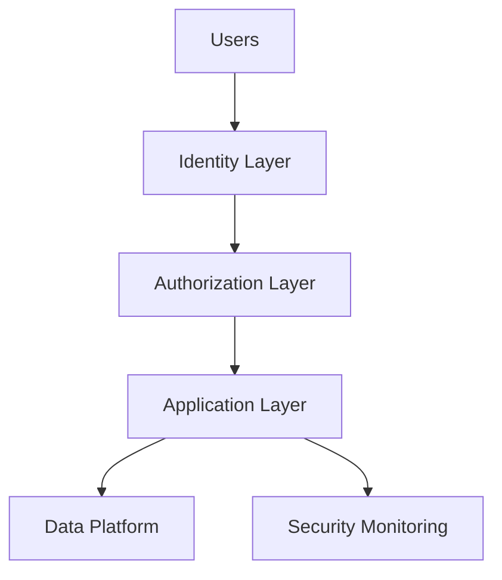

---

# Security Domains

| Domain | Purpose |
|----------|----------|
| Identity Security | Authentication and Identity |
| Access Security | Authorization and Permissions |
| Data Security | Data Protection |
| Application Security | API and Service Protection |
| AI Security | LLM and Agent Protection |
| Integration Security | MCP and External Services |
| Infrastructure Security | Cloud Resources |
| Operational Security | Monitoring and Incident Management |

---

# Identity Architecture

Identity management is responsible for user verification.

---

## Identity Providers

```text
Clerk
OIDC Providers
OAuth Providers
Enterprise SSO
```

---

## Authentication Flow

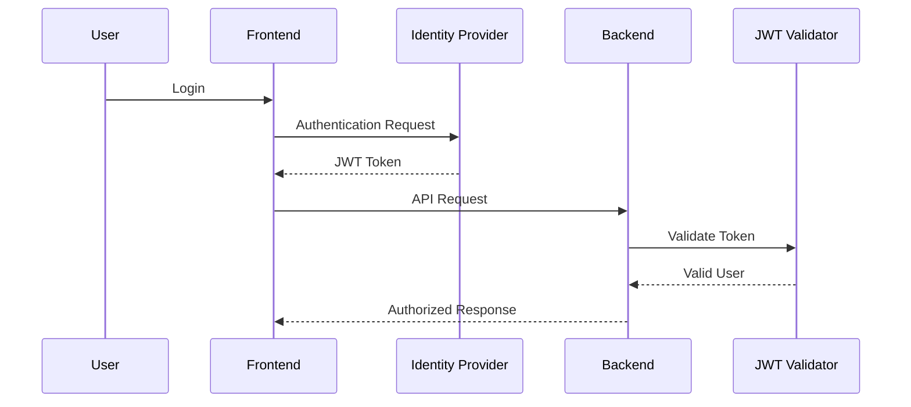

---

# Authentication Architecture

## Supported Methods

### Username / Password

Managed by identity provider.

---

### OAuth

Supported providers:

```text
Google
GitHub
Microsoft
```

---

### OpenID Connect

Supported for enterprise federation.

---

### Service-to-Service Authentication

Methods:

```text
JWT
IAM Roles
Service Tokens
```

---

# Authorization Architecture

After authentication, all actions require authorization.

---

## Authorization Layers

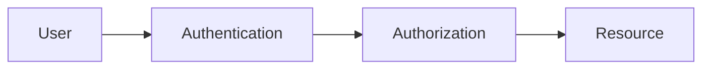

---

## Role Model

### Platform Roles

```text
ADMIN
OWNER
EDITOR
VIEWER
```

---

## Authorization Strategy

Authorization decisions use:

- User Role
- Workspace Ownership
- Resource Ownership
- Project Membership

---

# Identity and Access Management

IAM controls access to cloud resources.

---

## IAM Principles

### Least Privilege

Permissions are minimized.

---

### Role-Based Access

Access is granted through roles.

---

### No Long-Term Credentials

Temporary credentials are preferred.

---

## AWS IAM

Examples:

```text
Lambda Roles

AppRunner Roles

Terraform Roles

Developer Roles
```

---

# Secrets Management

Sensitive information must never be stored in source code.

---

## Protected Secrets

Examples:

```text
API Keys

Tokens

Passwords

Certificates

Encryption Keys
```

---

## Secrets Architecture

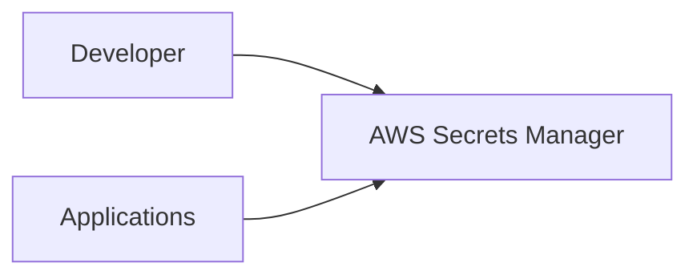

---

## Approved Secret Storage

```text
AWS Secrets Manager

GitHub Secrets

Environment Variables (Development)
```

---

# Data Protection Architecture

All sensitive data must be protected.

---

## Data Protection Layers

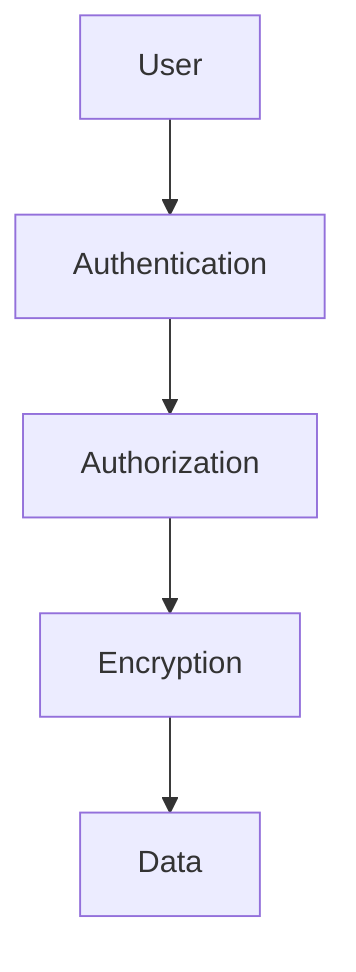

---

# Encryption

## Encryption in Transit

All communications use:

```text
TLS 1.2+
HTTPS
```

---

## Encryption at Rest

Protected resources:

```text
Aurora

S3

Vector Databases

Redis

Backups
```

---

# Application Security

Application security protects APIs and services.

---

## API Security

Controls:

- JWT Validation
- Input Validation
- Output Validation
- Error Handling
- Rate Limiting

---

## Service Security

Requirements:

```text
Authenticated

Authorized

Observable

Auditable
```

---

# AI Security

AI systems introduce additional attack surfaces.

---

## AI Security Objectives

Protect against:

- Prompt Injection
- Data Leakage
- Tool Abuse
- Jailbreak Attempts
- Sensitive Information Disclosure

---

## AI Security Architecture

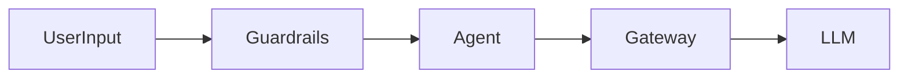

---

# Prompt Security

Controls:

- Input Validation
- Prompt Sanitization
- Prompt Templates
- Guardrails

---

# Model Gateway Security

All model interactions pass through a controlled gateway.

Benefits:

- Central Governance
- Auditing
- Monitoring
- Rate Limiting

---

# Agent Security

Agents receive access only to required capabilities.

---

## Agent Permissions

Examples:

| Agent | Permissions |
|----------|----------|
| Research Agent | Search |
| Security Agent | Analysis |
| Finance Agent | Finance Workflows |
| Healthcare Agent | Medical Knowledge Access |

---

## Agent Isolation

Principles:

- Least Privilege
- Explicit Permissions
- Auditable Actions

---

# MCP Security

MCP integrations introduce elevated risk.

---

## MCP Security Architecture

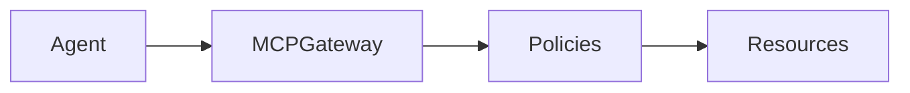

---

## MCP Controls

Every MCP request requires:

```text
Authentication

Authorization

Audit Logging

Policy Validation
```

---

# Infrastructure Security

Infrastructure security protects cloud resources.

---

---
---

# Security Zones Architecture

The platform enforces strict security boundaries through multiple isolation zones.

## Security Zone Model

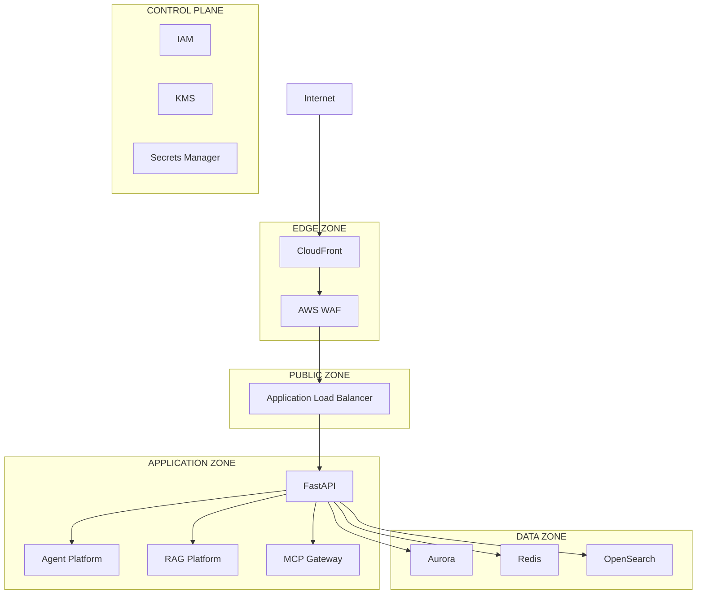

---

## Security Zone Matrix

| Zone | Internet Accessible | Description |
|--------|--------|--------|
| Edge Zone | Yes | CloudFront and WAF |
| Public Zone | Yes | Load Balancers only |
| Application Zone | No | APIs, Agents, MCP, RAG |
| Data Zone | No | Databases and Search |
| Control Plane | No | Identity and Security Services |

---

# Kubernetes Identity Architecture

The platform uses IAM Roles for Service Accounts (IRSA) for Kubernetes workloads.

## Objectives

- Eliminate static credentials
- Implement least privilege
- Isolate workloads
- Improve auditability

---

## Identity Flow

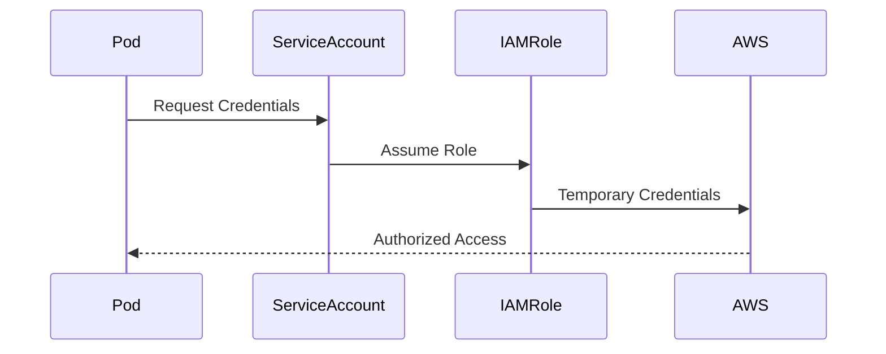

---

## IRSA Benefits

- No stored AWS credentials
- Temporary permissions
- Fine-grained authorization
- Cloud-native identity management
- Enhanced audit trails

---

# Key Management Architecture

Encryption relies on centralized key management.

## Encryption Hierarchy

```text
AWS Managed Keys
        ↓
Customer Managed Keys (CMK)
        ↓
Application Services
        ↓
Encrypted Resources
```

---

## Protected Resources

### Storage

- Amazon S3
- Aurora PostgreSQL
- OpenSearch
- Redis
- Backup Storage

### Compute

- EBS Volumes
- EKS Persistent Volumes

### Secrets

- AWS Secrets Manager
- Parameter Store

---

## Key Rotation

Requirements:

- Automatic key rotation
- Annual review
- Access logging
- Least privilege access

---

# Cloud Security Services

AWS native security services provide centralized protection and monitoring.

---

## AWS Security Hub

Purpose:

- Centralized security findings
- Compliance dashboards
- Multi-account visibility

---

## AWS GuardDuty

Purpose:

- Threat detection
- Anomaly detection
- Credential abuse detection

---

## AWS Inspector

Purpose:

- Vulnerability assessment
- Container scanning
- Continuous security assessment

---

## AWS Macie

Purpose:

- Sensitive data discovery
- Personal data detection
- Data classification

---

## AWS Config

Purpose:

- Configuration compliance
- Drift detection
- Governance enforcement

---

## AWS CloudTrail

Purpose:

- Audit logging
- Forensic investigations
- Regulatory compliance

---

# Security Services Architecture

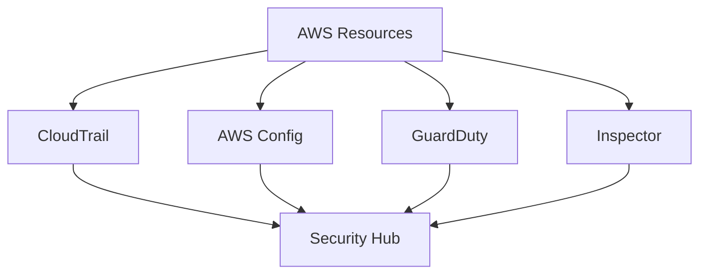

---

# Software Supply Chain Security

The platform enforces software supply chain security from commit to deployment.

---

## Security Pipeline

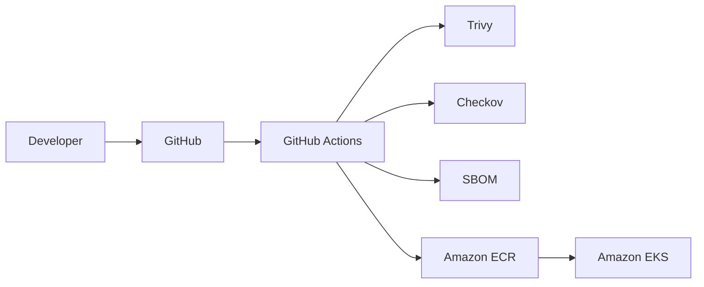

---

## Mandatory Controls

- Dependency Scanning
- Infrastructure Scanning
- Container Scanning
- SBOM Generation
- CVE Monitoring
- Signed Artifacts
- Immutable Releases

---

# OWASP LLM Security Coverage

The platform aligns with OWASP LLM security recommendations.

---

## Covered Risks

| Risk | Control |
|----------|----------|
| Prompt Injection | Input Validation |
| Data Leakage | Output Filtering |
| Excessive Agency | MCP Authorization |
| Tool Abuse | Policy Enforcement |
| Supply Chain Risks | Dependency Scanning |
| Training Data Poisoning | Data Validation |
| Model Theft | Access Controls |
| Sensitive Information Disclosure | Guardrails |

---

# Security Flow Matrix

## User Access Flows

| Source | Destination | Security Controls |
|----------|----------|----------|
| User | Frontend | OIDC, MFA |
| Frontend | API Gateway | JWT |
| API Gateway | FastAPI | Authorization Policies |

---

## Application Flows

| Source | Destination | Security Controls |
|----------|----------|----------|
| API | Agent Platform | RBAC |
| API | RAG Platform | RBAC |
| Agent | MCP Gateway | Policy Engine |
| MCP Gateway | Tools | Explicit Permissions |

---

## Data Access Flows

| Source | Destination | Security Controls |
|----------|----------|----------|
| API | Aurora | IAM + Security Groups |
| API | Redis | Security Groups |
| API | OpenSearch | IAM Policies |
| Service | S3 | IAM Role |

---

## Cloud Services Flows

| Source | Destination | Security Controls |
|----------|----------|----------|
| Service | Secrets Manager | IAM Role |
| Service | KMS | IAM Role |
| Service | Bedrock | Private Endpoint |
| Service | CloudWatch | IAM Role |

---

# STRIDE Threat Model

The platform uses STRIDE for threat identification.

---

## STRIDE Matrix

| Category | Example Threats |
|-----------|-----------|
| Spoofing | Credential Theft |
| Tampering | Data Manipulation |
| Repudiation | Audit Evasion |
| Information Disclosure | Data Leakage |
| Denial of Service | API Flooding |
| Elevation of Privilege | Unauthorized Access |

---

## STRIDE Controls

| STRIDE Category | Security Controls |
|-----------|-----------|
| Spoofing | MFA, OIDC, JWT |
| Tampering | Encryption, Integrity Checks |
| Repudiation | Audit Logs, CloudTrail |
| Information Disclosure | KMS, Secrets Management |
| Denial of Service | WAF, Rate Limiting |
| Elevation of Privilege | IAM, RBAC, IRSA |

---

# Security Maturity Roadmap

## Level 1 - Foundational

- MFA
- IAM
- Secrets Management
- Encryption

---

## Level 2 - Operational

- Security Hub
- GuardDuty
- Inspector
- Continuous Monitoring

---

## Level 3 - Advanced

- IRSA
- Zero Trust Enforcement
- Policy as Code
- Runtime Security

---

## Level 4 - Enterprise

- Multi-Account Security
- Automated Remediation
- Continuous Compliance
- Security Data Lake

---

---

## Infrastructure Controls

### Network Security

### Security Groups

### IAM

### Encryption

### Monitoring

### Backups

---

# Network Security

## Public Zone

```text
CloudFront
```

---

## Application Zone

```text
App Runner

Lambda
```

---

## Data Zone

```text
Aurora

Redis

Vector Database
```

---

# Security Monitoring

Security monitoring is mandatory.

---

## Monitoring Architecture

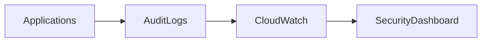

---

## Security Events

Examples:

```text
Login Attempts

Failed Authentication

Permission Violations

Agent Actions

MCP Access Events

Secrets Access

Configuration Changes
```

---

# Audit Architecture

All sensitive actions must be auditable.

---

## Audit Requirements

Every security-relevant action records:

```text
Who

What

When

Where

Result
```

---

# Incident Response

## Detection

Security event detected.

---

## Triage

Severity assessment.

---

## Containment

Limit impact.

---

## Investigation

Root cause analysis.

---

## Remediation

Recover affected systems.

---

## Post-Incident Review

Lessons learned.

---

# Security Responsibility Matrix

| Domain | Owner |
|----------|----------|
| Authentication | Identity Platform |
| Authorization | Security Platform |
| Secrets Management | Platform Engineering |
| IAM | Cloud Platform |
| Data Protection | Data Platform |
| AI Security | AI Platform |
| MCP Security | Integration Platform |
| Monitoring | Operations Platform |
| Incident Response | Security Platform |

---

# Security Controls Matrix

| Control | Mandatory |
|----------|----------|
| MFA | Yes |
| JWT Validation | Yes |
| Encryption in Transit | Yes |
| Encryption at Rest | Yes |
| Audit Logging | Yes |
| Secrets Manager | Yes |
| IAM Roles | Yes |
| Least Privilege | Yes |
| Security Monitoring | Yes |

---

# Related ADRs

- ADR-001 Multi-Cloud Strategy
- ADR-003 Agent Framework
- ADR-006 Model Gateway
- ADR-008 Security by Design
- ADR-009 Infrastructure as Code

---

# Related Documents

- enterprise-architecture.md
- application-architecture.md
- data-architecture.md
- cloud-architecture.md
- deployment-architecture.md

---

# Conclusion

The Security Architecture establishes the foundational security model for the AI Cloud MLOps Platform.

By applying zero-trust principles, layered defenses, strong identity management, secure AI controls, rigorous auditing and continuous monitoring, the platform maintains a secure posture while supporting scalable AI workloads across cloud-native environments.


# Zero Trust Security Architecture

## Zero Trust Principles

The platform implements a Zero Trust security model.

Core assumption:

```text
Never Trust
Always Verify
```

No user, device, application, service or workload is implicitly trusted.

Every request must be:

- Authenticated
- Authorized
- Logged
- Validated

---

## Zero Trust Control Layers

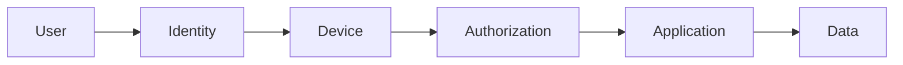

---

## Zero Trust Controls Matrix

| Control | Description | Mandatory |
|----------|----------|----------|
| MFA | Multi-Factor Authentication | Yes |
| JWT Validation | Token Verification | Yes |
| RBAC | Role-Based Access Control | Yes |
| Least Privilege | Minimal Permissions | Yes |
| Device Validation | Trusted Device Verification | Recommended |
| Session Expiration | Automatic Re-authentication | Yes |
| Audit Logging | Traceability | Yes |
| API Authentication | Protected APIs | Yes |
| Secrets Rotation | Key Rotation | Yes |
| Network Segmentation | Resource Isolation | Yes |

---

## Zero Trust Verification Points

All requests must be verified at:

```text
Frontend

API Gateway

Backend Services

Agent Runtime

MCP Gateway

Database Access

Cloud Resources
```

---

# Threat Matrix

## Security Threat Assessment

The following matrix identifies key threats relevant to the platform.

| Threat | Impact | Likelihood | Mitigation |
|----------|----------|----------|----------|
| Credential Theft | High | Medium | MFA, Secrets Management |
| Privilege Escalation | High | Medium | IAM, RBAC |
| API Abuse | High | High | Authentication, Rate Limiting |
| Data Exfiltration | Critical | Medium | Encryption, Monitoring |
| Prompt Injection | High | High | Input Validation, Guardrails |
| Tool Abuse | High | Medium | MCP Policies |
| Unauthorized MCP Access | Critical | Medium | Authorization Controls |
| Data Poisoning | High | Low | Data Validation |
| Vector Store Manipulation | High | Medium | Audit Controls |
| Agent Exploitation | High | Medium | Agent Isolation |
| Supply Chain Attack | Critical | Medium | Dependency Scanning |
| Infrastructure Misconfiguration | Critical | Medium | Terraform Governance |
| Secrets Exposure | Critical | Low | Secrets Manager |
| Denial of Service | High | Medium | WAF, Rate Limiting |
| Insider Threat | Critical | Low | Auditing, Least Privilege |

---

## AI Threat Landscape

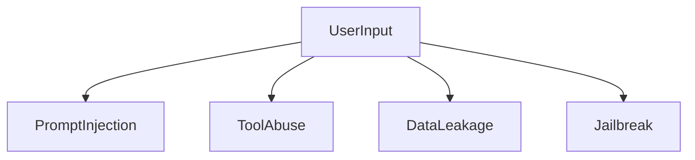

---

## AI Security Controls

| Threat | Control |
|----------|----------|
| Prompt Injection | Input Validation |
| Prompt Leakage | Prompt Templates |
| Hallucination | RAG Validation |
| Tool Abuse | MCP Authorization |
| Data Leakage | Output Filtering |
| Jailbreak Attempts | Guardrails |
| Excessive Tool Usage | Rate Limiting |
| Agent Escalation | Agent Isolation |

---

# Compliance Requirements

## Compliance Objectives

The platform is designed to support enterprise compliance requirements.

Supported frameworks include:

```text
GDPR
ISO 27001
SOC 2
NIST Cybersecurity Framework
AWS Well-Architected Framework
```

---

# GDPR Requirements

## Personal Data Protection

Requirements:

- Explicit data ownership
- Right to delete data
- Right to export data
- Data minimization
- Retention controls

---

## GDPR Controls

| Requirement | Implementation |
|-------------|-------------|
| Data Access | RBAC |
| Data Export | APIs |
| Data Deletion | Automated Processes |
| Auditability | Audit Logs |
| Encryption | Mandatory |

---

# ISO 27001 Alignment

## Security Domains

| ISO Domain | Platform Controls |
|------------|------------|
| Access Control | IAM, RBAC |
| Cryptography | Encryption |
| Operations Security | Monitoring |
| Supplier Security | Dependency Scanning |
| Incident Management | Incident Response |
| Logging | Audit Events |

---

# SOC 2 Alignment

## Security

Supported through:

- Authentication
- Authorization
- Encryption

---

## Availability

Supported through:

- Monitoring
- Alerting
- Redundancy

---

## Confidentiality

Supported through:

- Data Classification
- Secrets Management
- Access Controls

---

# NIST Alignment

## Identify

```text
Asset Inventory
Ownership Matrix
Data Classification
```

---

## Protect

```text
IAM
Encryption
Secrets Management
```

---

## Detect

```text
CloudWatch
LangFuse
Security Monitoring
```

---

## Respond

```text
Incident Response
Containment
Investigation
```

---

## Recover

```text
Backups
Disaster Recovery
Business Continuity
```

---

# Compliance Traceability Matrix

| Requirement | Evidence |
|------------|------------|
| Authentication | Clerk, JWT |
| Authorization | IAM, RBAC |
| Encryption | TLS + KMS |
| Auditing | Audit Logs |
| Monitoring | CloudWatch |
| Secrets Protection | Secrets Manager |
| Incident Response | Security Runbooks |
| Data Governance | Data Architecture |

---

# Security Readiness Checklist

## Identity Security

- [ ] MFA Enabled
- [ ] RBAC Configured
- [ ] JWT Validation Enabled

---

## Data Security

- [ ] Encryption at Rest
- [ ] Encryption in Transit
- [ ] Backup Policies Defined

---

## AI Security

- [ ] Prompt Validation
- [ ] Guardrails Enabled
- [ ] Tool Access Control

---

## Operational Security

- [ ] Monitoring Enabled
- [ ] Alerting Configured
- [ ] Audit Logs Retained

---

## Compliance

- [ ] GDPR Controls Implemented
- [ ] ISO 27001 Controls Mapped
- [ ] SOC 2 Controls Mapped
- [ ] NIST Categories Covered