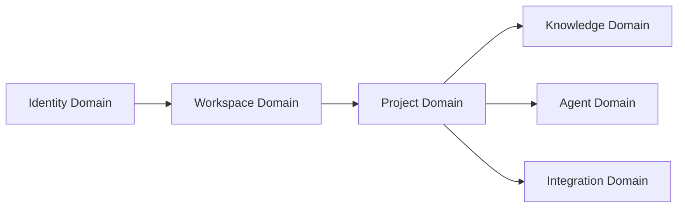
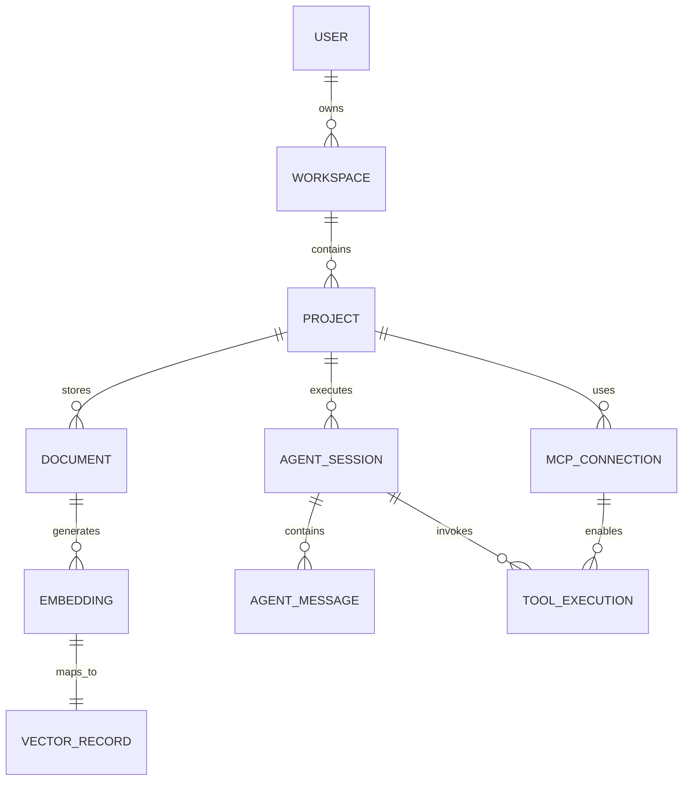
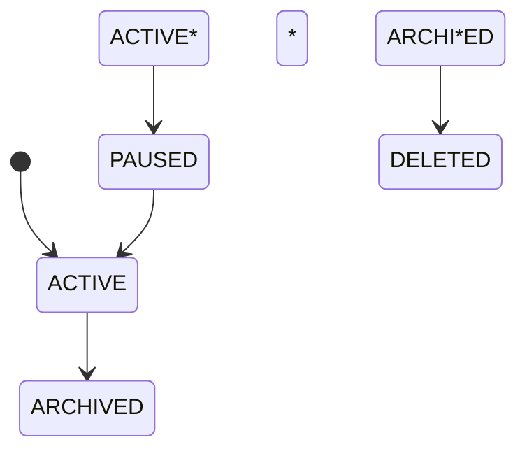

# Logical Data Model

> Logical Data Model for the AI Cloud MLOps Platform.

This document defines the major business entities, their relationships, cardinalities, lifecycle states and ownership responsibilities across the platform.

The model is technology-agnostic and represents the business view of the platform before physical database implementation.

---

# Purpose

The logical data model provides a shared understanding of:

- Core business entities
- Entity relationships
- Ownership boundaries
- Cardinality rules
- Lifecycle constraints
- Domain boundaries

It serves as the foundation for:

- Database Design
- API Contracts
- Pydantic Models
- Agent Workflows
- MCP Integrations
- Security Controls
- Data Governance

---

# Core Domains

The platform is organized into six primary domains.



---

# Domain Responsibilities

| Domain | Purpose |
|----------|----------|
| Identity | Users, Roles and Access Control |
| Workspace | Organization and Collaboration |
| Project | Business Context |
| Knowledge | Documents, Embeddings and Vectors |
| Agent | Agent Sessions and Conversations |
| Integration | MCP Connections and Tool Executions |

---

# Enterprise Logical Data Model



---

# Entity Definitions

## USER

Represents an authenticated platform user.

### Attributes

| Attribute | Description |
|------------|------------|
| User ID | Unique identifier |
| Email | Login account |
| Role | Permission level |
| Created At | Creation timestamp |

### Responsibilities

- Identity
- Authentication
- Project Ownership

---

## WORKSPACE

Represents a collaborative container.

### Attributes

| Attribute | Description |
|------------|------------|
| Workspace ID | Unique identifier |
| Name | Workspace name |
| Plan | Subscription tier |

### Responsibilities

- Project grouping
- Team organization
- Resource ownership

---

## PROJECT

Represents a business context.

### Attributes

| Attribute | Description |
|------------|------------|
| Project ID | Unique identifier |
| Name | Project name |
| Status | Current lifecycle state |

### Responsibilities

- Knowledge management
- Agent execution
- MCP integrations

---

## DOCUMENT

Represents stored knowledge assets.

### Attributes

| Attribute | Description |
|------------|------------|
| Document ID | Unique identifier |
| Source Type | Origin type |
| Title | Document title |

### Source Types

```text
PDF
WEB
SHAREPOINT
S3
CSV
JSON
```

---

## EMBEDDING

Represents vectorized content.

### Attributes

| Attribute | Description |
|------------|------------|
| Embedding ID | Unique identifier |
| Model | Embedding model |
| Chunk Count | Generated chunks |

### Supported Models

```text
Titan
OpenAI
BGE
MiniLM
```

---

## VECTOR RECORD

Represents indexed semantic data.

### Attributes

| Attribute | Description |
|------------|------------|
| Vector ID | Unique identifier |
| Collection | Vector collection |
| Dimensions | Vector dimensions |

---

## AGENT SESSION

Represents a single agent execution.

### Attributes

| Attribute | Description |
|------------|------------|
| Session ID | Unique identifier |
| Agent Type | Agent category |
| Status | Lifecycle state |

### Agent Types

```text
RESEARCH
HEALTHCARE
SECURITY
FINANCE
COORDINATOR
```

---

## AGENT MESSAGE

Represents communication within a session.

### Attributes

| Attribute | Description |
|------------|------------|
| Message ID | Unique identifier |
| Role | Message role |
| Content | Message content |

### Allowed Roles

```text
SYSTEM
USER
ASSISTANT
TOOL
```

---

## MCP CONNECTION

Represents an external MCP integration.

### Attributes

| Attribute | Description |
|------------|------------|
| Connection ID | Unique identifier |
| Provider | MCP Provider |
| Status | Enabled status |

### Supported Providers

```text
GITHUB
FILESYSTEM
POSTGRES
AWS
AZURE
GCP
```

---

## TOOL EXECUTION

Represents execution of a tool.

### Attributes

| Attribute | Description |
|------------|------------|
| Execution ID | Unique identifier |
| Tool Name | Invoked tool |
| Status | Execution status |

### Status Values

```text
PENDING
RUNNING
SUCCESS
FAILED
TIMEOUT
```

---

# Cardinality Matrix

| Relationship | Cardinality |
|--------------|-------------|
| User → Workspace | 1 : N |
| Workspace → Project | 1 : N |
| Project → Document | 1 : N |
| Project → Agent Session | 1 : N |
| Project → MCP Connection | 1 : N |
| Document → Embedding | 1 : N |
| Embedding → Vector Record | 1 : 1 |
| Agent Session → Agent Message | 1 : N |
| Agent Session → Tool Execution | 1 : N |
| MCP Connection → Tool Execution | 1 : N |

---

# Business Constraints

## User Constraints

```text
EMAIL must be unique.

ROLE is mandatory.

USER_ID is immutable.
```

---

## Workspace Constraints

```text
Workspace names must be unique per owner.
```

---

## Project Constraints

```text
Projects belong to exactly one workspace.
```

Allowed statuses:

```text
ACTIVE
PAUSED
ARCHIVED
DELETED
```

---

## Document Constraints

```text
Documents must belong to one project.
```

Supported source types:

```text
PDF
WEB
SHAREPOINT
S3
CSV
JSON
```

---

## Embedding Constraints

```text
Embeddings require one parent document.

Embedding dimensions must match model specifications.
```

---

## Agent Constraints

```text
Sessions require an agent type.

Sessions require at least one message.
```

---

## MCP Constraints

```text
Tool executions must reference a valid MCP connection.
```

---

# Referential Integrity Rules

```text
A Workspace cannot exist without a User.

A Project cannot exist without a Workspace.

A Document cannot exist without a Project.

An Embedding cannot exist without a Document.

A Vector Record cannot exist without an Embedding.

An Agent Session cannot exist without a Project.

An Agent Message cannot exist without a Session.

A Tool Execution cannot exist without a Session.

A Tool Execution cannot exist without an MCP Connection.
```

---

# Project Lifecycle



---

# Agent S*ssion Lifecycle

```mermaid
stateD*agram-v2

    [*] --> CREATED

   *CREATED --> RUNNING

    RUNNING -*> COMPLETED

    RUNNING --> FAILE*

    COMPLETED --> CLOSED

    FA*LED --> CLOSED
```

---

# Knowled*e Lifecycle

```mermaid
stateDiagr*m-v2

    [*] --> INGESTED

    IN*ESTED --> CHUNKED

    CHUNKED -->*EMBEDDED

    EMBEDDED --> INDEXED*
    INDEXED --> SEARCHABLE

    S*ARCHABLE --> ARCHIVED
```

---

# *gent Memory Model

```mermaid
flow*hart LR

    Session["Session Memo*y"]

    ShortTerm["Short-Term Mem*ry"]

    LongTerm["Long-Term Memo*y"]

    Knowledge["Knowledge Asse*s"]

    Session --> ShortTerm

  * ShortTerm --> LongTerm

    LongT*rm --> Knowledge
```

---

# Stora*e Mapping

| Entity | Storage Syst*m |
|----------|----------|
| User*| Aurora |
| Workspace | Aurora |
* Project | Aurora |
| Agent Sessio* | Aurora |
| Agent Message | Auro*a |
| MCP Connection | Aurora |
| *ool Execution | Aurora |
| Documen*s | S3 |
| Embeddings | Vector Dat*base |
| Vector Records | Vector D*tabase |
| Session Cache | Redis |*| Agent Memory Cache | Redis |
| L*gs | CloudWatch |
| Traces | LangF*se |

---

# Ownership Matrix

| D*main | Owner |
|----------|-------*--|
| Identity Domain | Applicatio* Platform |
| Workspace Domain | A*plication Platform |
| Project Dom*in | Application Platform |
| Know*edge Domain | RAG Platform |
| Age*t Domain | AI Platform |
| Integra*ion Domain | MCP Platform |
| Obse*vability Domain | Platform Operati*ns |
| Security Domain | Security *latform |

---

# Data Quality Rul*s

| Entity | Quality Rule |
|----*-----|----------|
| User | Unique *mail |
| Workspace | Unique Name p*r Owner |
| Project | Mandatory St*tus |
| Document | Valid Source Ty*e |
| Embedding | Valid Model Refe*ence |
| Agent Session | Valid Age*t Type |
| Agent Message | Valid R*le |
| MCP Connection | Valid Provider |
| Tool Execution | Valid Status |

---

# Future Entities

Planned entities include:

- Prompt Template
- Agent Memory
- Evaluation Dataset
- Workflow
- Cost Record
- Model Registry
- Agent Marketplace
- Guardrail Policy

---

# Related Documents

- enterprise-architecture.md
- application-architecture.md
- data-architecture.md
- security-architecture.md
- cloud-architecture.md

---

# Related ADRs

- ADR-002 Vector Database Strategy
- ADR-003 Agent Framework
- ADR-006 Model Gateway
- ADR-007 RAG Platform
- ADR-008 Security by Design

---

# Conclusion

The Logical Data Model establishes the foundational business entities and relationships that support the AI Cloud MLOps Platform.

By formalizing domains, cardinalities, constraints, ownership boundaries and lifecycle rules, the model enables consistent implementation across application services, AI agents, MCP integrations, RAG workflows and future platform capabilities.