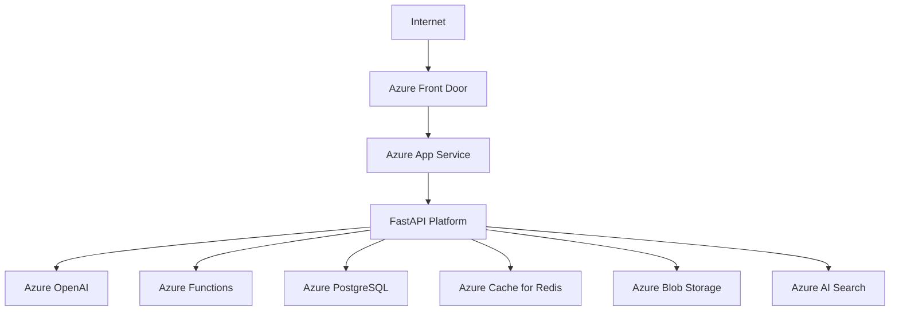
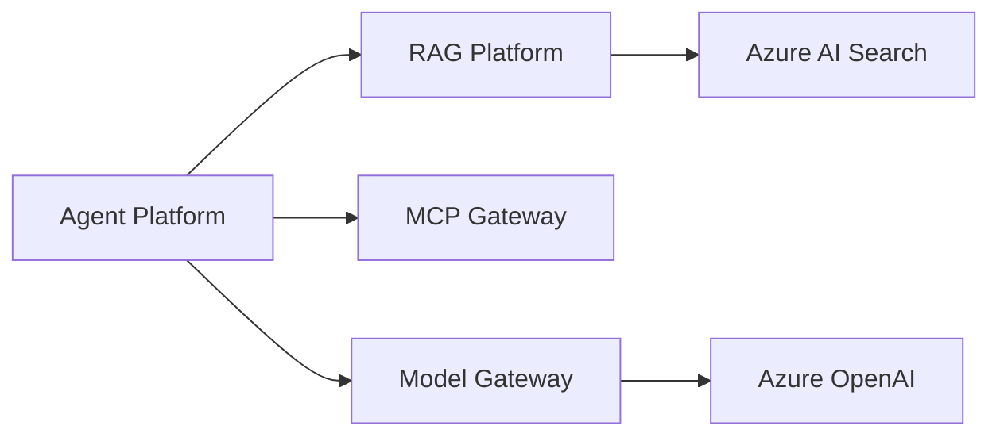
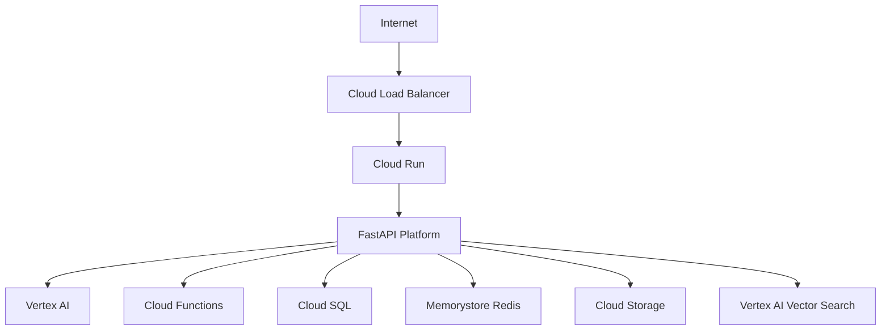
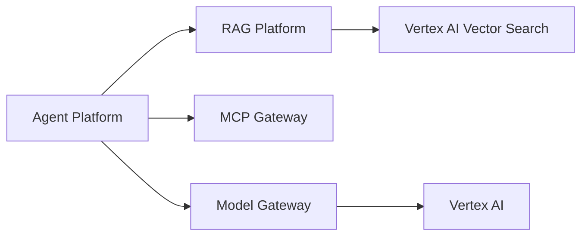
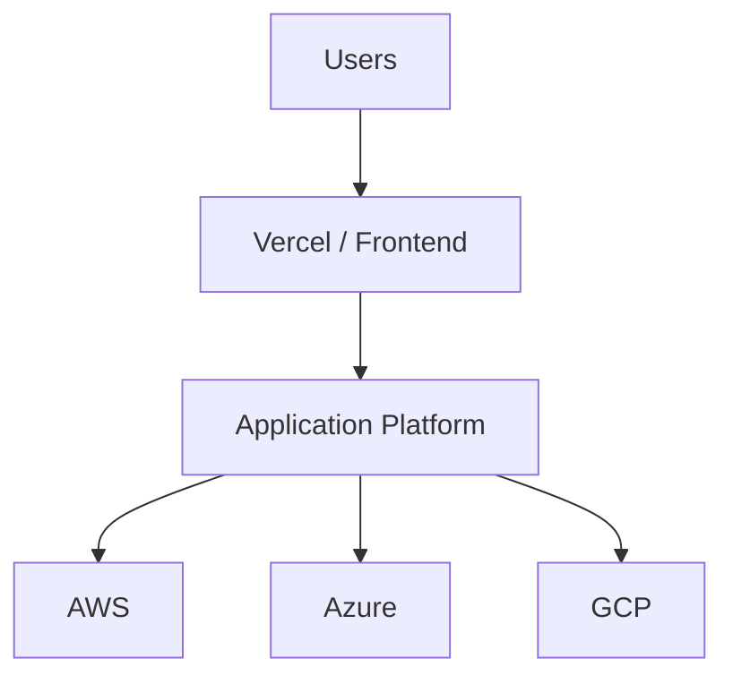
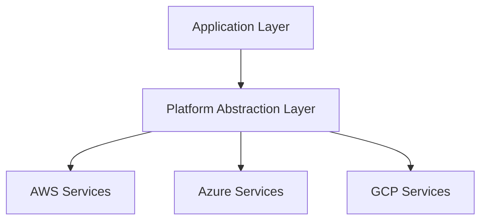

# Azure Reference Architecture

## Purpose

Reference deployment architecture on Microsoft Azure.

---

## Azure AI Platform

---

## Azure Service Mapping

| Platform Capability | Azure Service |
|--------------------|---------------|
| CDN | Azure Front Door |
| Application Hosting | Azure App Service |
| Serverless | Azure Functions |
| Relational Database | Azure PostgreSQL |
| Object Storage | Azure Blob Storage |
| Cache | Azure Redis Cache |
| Vector Search | Azure AI Search |
| Foundation Models | Azure OpenAI |
| Secrets Management | Azure Key Vault |
| Monitoring | Azure Monitor |

---

## Azure AI Architecture

# GCP Reference Architecture

## Purpose

Reference deployment architecture on Google Cloud Platform.

---

## GCP AI Platform

---

## GCP Service Mapping

| Platform Capability | GCP Service |
|--------------------|-------------|
| Load Balancer | Cloud Load Balancer |
| Application Hosting | Cloud Run |
| Serverless | Cloud Functions |
| Relational Database | Cloud SQL |
| Object Storage | Cloud Storage |
| Cache | Memorystore |
| Vector Search | Vertex AI Vector Search |
| Foundation Models | Vertex AI |
| Secrets | Secret Manager |
| Monitoring | Cloud Operations |

---

## GCP AI Architecture

## Multi-Cloud Service Mapping

| Capability | AWS | Azure | GCP |
|------------|-----|--------|-----|
| Frontend Hosting | Vercel | Static Web Apps | Firebase Hosting |
| API Hosting | App Runner | App Service | Cloud Run |
| Serverless | Lambda | Functions | Cloud Functions |
| Object Storage | S3 | Blob Storage | Cloud Storage |
| Database | Aurora | PostgreSQL | Cloud SQL |
| Cache | Redis | Azure Redis | Memorystore |
| Foundation Models | Bedrock | Azure OpenAI | Vertex AI |
| Vector Search | OpenSearch / Vector DB | AI Search | Vertex AI Search |
| Secrets | Secrets Manager | Key Vault | Secret Manager |
| Monitoring | CloudWatch | Azure Monitor | Cloud Operations |
| Infrastructure as Code | Terraform | Terraform | Terraform |

## Multi-Cloud Enterprise Architecture

## Cloud Abstraction Strategy

