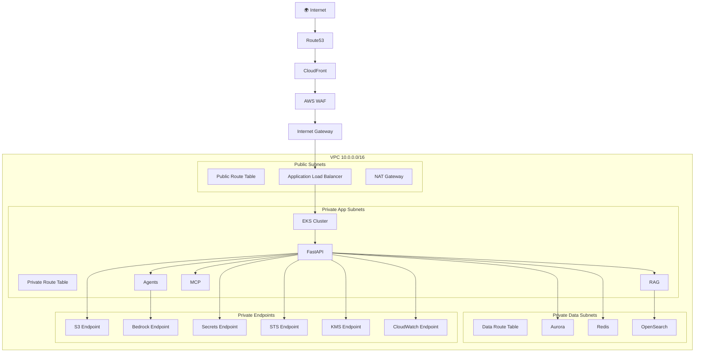

# Network Architecture

> Enterprise-grade network architecture for the AI Cloud MLOps Platform, designed around AWS Landing Zone principles, Zero Trust networking, multi-AZ resiliency, private service access, and cloud-native security controls.

---

# Table of Contents

- Overview
- Architecture Principles
- Network Topology
- CIDR Allocation Strategy
- Availability Zones
- Route Tables
- Internet Connectivity
- Private Connectivity
- VPC Endpoints
- Kubernetes Networking
- Security Architecture
- Traffic Flows
- High Availability
- Disaster Recovery
- Network Observability
- Future Enhancements
- Network Diagram

---

# Overview

The platform network architecture follows a hub-and-secure-spoke model built on AWS best practices.

Key goals:

- High availability
- Multi-AZ resiliency
- Secure east-west communication
- Controlled north-south traffic
- Private AWS service consumption
- Zero Trust principles
- Kubernetes-native networking
- Enterprise observability
- Future multi-cloud extensibility

---

# Architecture Principles

## Zero Trust

No network location is inherently trusted.

All communication requires:

- Authentication
- Authorization
- Encryption

---

## Defense in Depth

Security controls exist at multiple layers:

- AWS Organizations
- VPC Boundaries
- Route Tables
- Security Groups
- Network ACLs
- IAM Policies
- Kubernetes Policies

---

## Private-by-Default

Production workloads operate in private subnets.

Direct internet exposure is minimized.

---

## Multi-AZ Resilience

Critical services span multiple Availability Zones.

No single AZ failure should impact platform availability.

---

# Network Topology

```text
Internet
    │
    ▼
CloudFront
    │
    ▼
AWS WAF
    │
    ▼
Application Load Balancer
    │
    ▼
Private Application Tier
    │
    ├── FastAPI
    ├── Agents
    ├── RAG
    └── MCP
    │
    ▼
Private Data Tier
    ├── Aurora
    ├── Redis
    ├── OpenSearch
    └── S3
```

---

# CIDR Allocation Strategy

## Primary VPC

```text
VPC: 10.0.0.0/16
```

---

## Public Subnets

| Availability Zone | CIDR |
|----------|----------|
| Public AZ-A | 10.0.1.0/24 |
| Public AZ-B | 10.0.2.0/24 |

Purpose:

- Load Balancers
- NAT Gateways

---

## Application Subnets

| Availability Zone | CIDR |
|----------|----------|
| App AZ-A | 10.0.11.0/24 |
| App AZ-B | 10.0.12.0/24 |

Purpose:

- EKS Nodes
- FastAPI
- Agents
- RAG Services
- MCP Services

---

## Data Subnets

| Availability Zone | CIDR |
|----------|----------|
| Data AZ-A | 10.0.21.0/24 |
| Data AZ-B | 10.0.22.0/24 |

Purpose:

- Aurora
- Redis
- OpenSearch

---

## Reserved Capacity

| Purpose | CIDR |
|----------|----------|
| Future Expansion | 10.0.30.0/24 |
| Shared Services | 10.0.40.0/24 |
| Connectivity | 10.0.50.0/24 |

---

# Availability Zones

The production environment uses at least two Availability Zones.

```text
eu-west-1a
eu-west-1b
```

Recommended evolution:

```text
eu-west-1a
eu-west-1b
eu-west-1c
```

for N+1 fault tolerance.

---

# Route Tables

## Public Route Table

Associated With:

```text
Public AZ-A
Public AZ-B
```

Routes:

```text
10.0.0.0/16 → local

0.0.0.0/0 → Internet Gateway
```

---

## Private Application Route Table

Associated With:

```text
App AZ-A
App AZ-B
```

Routes:

```text
10.0.0.0/16 → local

0.0.0.0/0 → NAT Gateway
```

Purpose:

- Download container images
- OS patching
- External API access

---

## Private Data Route Table

Associated With:

```text
Data AZ-A
Data AZ-B
```

Routes:

```text
10.0.0.0/16 → local
```

No direct internet route.

Purpose:

- Strong isolation
- Reduced attack surface

---

# Internet Connectivity

## Internet Gateway

```text
IGW
```

Responsibilities:

- Incoming web traffic
- Public load balancer connectivity

---

## NAT Gateway

Deployed per Availability Zone.

```text
NAT-A
NAT-B
```

Responsibilities:

- Outbound internet access
- Patch management
- Package downloads

No inbound traffic allowed.

---

# Private Connectivity

## East-West Traffic

Service-to-service communication remains entirely private.

Examples:

```text
API → Agent Services

API → RAG

API → MCP

Agent → Bedrock Endpoint

RAG → OpenSearch
```

---

## North-South Traffic

```text
Internet
  ↓
CloudFront
  ↓
WAF
  ↓
ALB
  ↓
API
```

Only approved entry points are exposed.

---

# VPC Endpoints

The architecture minimizes internet traversal through AWS PrivateLink and Gateway Endpoints.

---

## Gateway Endpoints

### Amazon S3

```text
com.amazonaws.region.s3
```

Benefits:

- Private access
- Lower NAT costs
- Better performance

---

### DynamoDB (optional)

```text
com.amazonaws.region.dynamodb
```

Future usage.

---

## Interface Endpoints

### Bedrock

```text
com.amazonaws.region.bedrock-runtime
```

Used by:

- Agent Platform
- RAG Services
- Evaluation Services

---

### Secrets Manager

```text
com.amazonaws.region.secretsmanager
```

Used by:

- FastAPI
- Agents
- Kubernetes Workloads

---

### STS

```text
com.amazonaws.region.sts
```

Used for:

- IAM Role Assumption
- IRSA Authentication

---

### ECR API

```text
com.amazonaws.region.ecr.api
```

---

### ECR Docker

```text
com.amazonaws.region.ecr.dkr
```

Used for container image pulls.

---

### CloudWatch

```text
com.amazonaws.region.logs
```

Used for:

- Logs
- Metrics
- Monitoring

---

### Systems Manager

```text
com.amazonaws.region.ssm
```

Used for:

- Fleet Management
- Remote Operations

---

### KMS

```text
com.amazonaws.region.kms
```

Used for:

- Encryption Keys
- Volume Encryption
- Secrets Encryption

---

# Kubernetes Networking

## EKS Cluster

Runs in:

```text
Private App Subnets
```

Only ALB remains publicly accessible.

---

## Ingress

```text
AWS Load Balancer Controller
```

Responsibilities:

- ALB Management
- HTTPS Routing
- TLS Termination

---

## Service Discovery

```text
CoreDNS
```

Internal access:

```text
api-service

agent-service

rag-service

mcp-service
```

---

## Network Policies

Recommended:

```text
Calico

or

Cilium
```

For:

- Workload Segmentation
- Zero Trust Networking

---

# Security Architecture

## Security Groups

Layered model:

```text
ALB SG
    ↓

API SG
    ↓

Agent SG
    ↓

Database SG
```

Only required traffic is permitted.

---

## Network ACLs

Used as supplemental controls.

Examples:

```text
Allow HTTPS

Allow Internal Traffic

Deny Unknown Sources
```

---

# Traffic Flows

## User Requests

```text
User
 ↓
CloudFront
 ↓
WAF
 ↓
ALB
 ↓
FastAPI
```

---

## RAG Queries

```text
User
 ↓
API
 ↓
Retriever
 ↓
Vector Store
 ↓
Bedrock
 ↓
Response
```

---

## Agent Execution

```text
API
 ↓
Agent
 ↓
MCP
 ↓
Tool
 ↓
Bedrock
 ↓
Result
```

---

# High Availability

Implemented through:

- Multi-AZ Deployment
- Aurora Replication
- Redis Replication
- EKS Node Groups
- Multiple NAT Gateways
- Multiple Application Load Balancers

Target:

```text
99.9%+
```

availability.

---

# Disaster Recovery

## Backup Strategy

Aurora:

```text
Continuous Backup
```

S3:

```text
Versioning
Cross Region Replication
```

---

## Recovery Objectives

| Metric | Target |
|----------|----------|
| RPO | < 15 min |
| RTO | < 1 hour |

---

# Network Observability

## Metrics

Collected via:

- CloudWatch
- Prometheus

Monitored:

- Latency
- Throughput
- Connection Errors
- Endpoint Health

---

## Logging

Sources:

- VPC Flow Logs
- ALB Logs
- WAF Logs
- Kubernetes Logs

---

## Tracing

OpenTelemetry

```text
Frontend
 ↓
API
 ↓
Agent
 ↓
RAG
 ↓
Model
```

End-to-end visibility.

---

# Future Enhancements

## Multi-Account Networking

```text
AWS Organizations
```

Separate:

- Production
- Staging
- Development
- Shared Services

---

## Transit Gateway

For:

```text
Multiple VPCs

Shared Services

Hybrid Networking
```

---

## Multi-Cloud Networking

Connectivity between:

```text
AWS

Azure

Google Cloud
```

through secure private links.

---

# Network Diagram



---


# Network Flow Matrix

## North-South Traffic

| Source | Destination | Protocol | Port | Purpose |
|----------|----------|----------|----------|----------|
| Internet | CloudFront | HTTPS | 443 | User Access |
| CloudFront | WAF | HTTPS | 443 | Edge Protection |
| WAF | ALB | HTTPS | 443 | Secure Routing |
| ALB | FastAPI | HTTPS | 443 | API Requests |

---

## East-West Traffic

| Source | Destination | Protocol | Port | Purpose |
|----------|----------|----------|----------|----------|
| FastAPI | Agent Platform | HTTPS | 443 | Agent Execution |
| FastAPI | RAG Platform | HTTPS | 443 | Retrieval Workflow |
| FastAPI | MCP Gateway | HTTPS | 443 | Tool Access |
| Agents | MCP Gateway | HTTPS | 443 | Tool Consumption |
| RAG | OpenSearch | HTTPS | 443 | Vector Search |
| RAG | S3 | HTTPS | 443 | Document Retrieval |
| Agents | Bedrock Endpoint | HTTPS | 443 | Model Invocation |

---

## Data Layer Traffic

| Source | Destination | Protocol | Port |
|----------|----------|----------|----------|
| FastAPI | Aurora PostgreSQL | TCP | 5432 |
| FastAPI | Redis | TCP | 6379 |
| Agents | Aurora PostgreSQL | TCP | 5432 |
| Agents | Redis | TCP | 6379 |
| RAG | OpenSearch | HTTPS | 443 |

---

## Observability Traffic

| Source | Destination | Protocol | Port |
|----------|----------|----------|----------|
| Applications | CloudWatch | HTTPS | 443 |
| Applications | Prometheus | TCP | 9090 |
| Prometheus | Grafana | TCP | 3000 |
| Applications | OpenTelemetry Collector | gRPC | 4317 |
| Applications | OpenTelemetry Collector | HTTP | 4318 |

---

## Administration Traffic

| Source | Destination | Protocol | Port |
|----------|----------|----------|----------|
| DevOps Engineers | AWS Console | HTTPS | 443 |
| GitHub Actions | EKS | HTTPS | 443 |
| ArgoCD | Kubernetes API | HTTPS | 443 |


# Private Endpoint Matrix

| Service | Endpoint Type | Endpoint Name | Purpose |
|----------|----------|----------|----------|
| S3 | Gateway | com.amazonaws.region.s3 | Object Storage |
| DynamoDB | Gateway | com.amazonaws.region.dynamodb | NoSQL Access |
| Bedrock | Interface | com.amazonaws.region.bedrock-runtime | LLM Access |
| ECR API | Interface | com.amazonaws.region.ecr.api | Container Registry |
| ECR Docker | Interface | com.amazonaws.region.ecr.dkr | Image Pulls |
| CloudWatch Logs | Interface | com.amazonaws.region.logs | Logging |
| CloudWatch Monitoring | Interface | com.amazonaws.region.monitoring | Metrics |
| Secrets Manager | Interface | com.amazonaws.region.secretsmanager | Secret Retrieval |
| STS | Interface | com.amazonaws.region.sts | IAM Roles |
| Systems Manager | Interface | com.amazonaws.region.ssm | Fleet Operations |
| KMS | Interface | com.amazonaws.region.kms | Encryption Keys |


