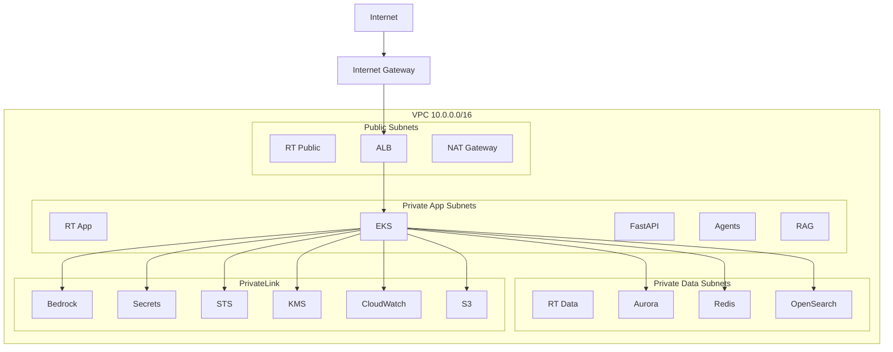

# Security Zone Matrix

| Zone | Internet Accessible | Description |
|--------|--------|--------|
| Edge | Yes | CloudFront, WAF |
| Public | Yes | Load Balancers |
| Application | No | FastAPI, Agents, RAG, MCP |
| Data | No | Aurora, Redis, OpenSearch |
| Management | No | Monitoring and Administration |
| PrivateLink | No | AWS Service Endpoints |