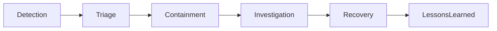

# Security Incident Response Runbook

---

# Objective

Provide a structured process for responding to security incidents.

---

# Detection

Sources:

- LangFuse
- CloudWatch
- Grafana
- Security Alerts

---

# Triage

Severity Levels:

| Severity | Description |
|----------|----------|
| P1 | Critical |
| P2 | High |
| P3 | Medium |
| P4 | Low |

---

# Response Process

---

# Containment

Actions:

- Revoke Credentials
- Disable Users
- Stop Services
- Restrict Access

---

# Investigation

Collect:

- Logs
- Traces
- Audit Events
- Tool Executions

---

# Recovery

Verify:

- Security Controls
- System Integrity
- Data Consistency