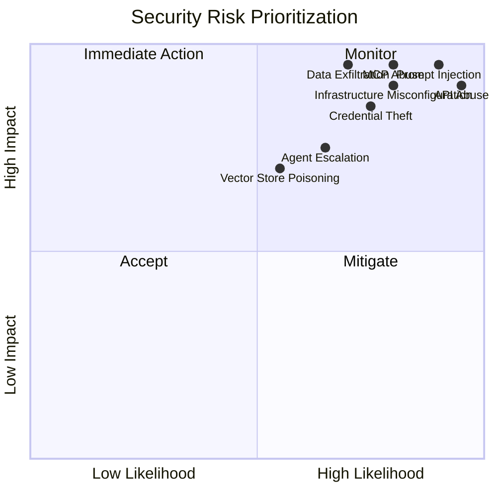

# DREAD Risk Assessment Model

> Quantitative risk scoring model used to prioritize security remediation efforts.

---

# Purpose

The DREAD framework evaluates threats according to five dimensions:

| Dimension | Description |
|------------|------------|
| Damage Potential | Impact if exploited |
| Reproducibility | Ease of reproducing the attack |
| Exploitability | Difficulty of exploitation |
| Affected Users | Scope of impact |
| Discoverability | Ease of discovering the vulnerability |

---

# Scoring Model

Each category receives a score from:

```text
1 = Negligible

5 = Moderate

10 = Critical
```

Risk Score Formula:

```text
(Damage + Reproducibility + Exploitability +
Affected Users + Discoverability)

÷

5
```

---

# DREAD Classification

| Score | Classification |
|----------|----------|
| 0 - 3 | Low |
| 3 - 6 | Moderate |
| 6 - 8 | High |
| 8 - 10 | Critical |

---

# Threat Evaluation Matrix

## Credential Theft

| Factor | Score |
|----------|----------|
| Damage Potential | 9 |
| Reproducibility | 8 |
| Exploitability | 7 |
| Affected Users | 8 |
| Discoverability | 7 |

### Score

```text
7.8
```

### Classification

```text
HIGH
```

### Mitigations

- MFA
- Session Expiration
- Conditional Access
- Login Monitoring

---

## API Abuse

| Factor | Score |
|----------|----------|
| Damage Potential | 8 |
| Reproducibility | 10 |
| Exploitability | 9 |
| Affected Users | 8 |
| Discoverability | 8 |

### Score

```text
8.6
```

### Classification

```text
CRITICAL
```

### Mitigations

- Authentication
- Rate Limiting
- API Gateway Policies
- WAF

---

## Data Exfiltration

| Factor | Score |
|----------|----------|
| Damage Potential | 10 |
| Reproducibility | 7 |
| Exploitability | 6 |
| Affected Users | 10 |
| Discoverability | 5 |

### Score

```text
7.6
```

### Classification

```text
HIGH
```

### Mitigations

- Encryption
- Audit Logging
- DLP Controls
- Monitoring

---

## Prompt Injection

| Factor | Score |
|----------|----------|
| Damage Potential | 9 |
| Reproducibility | 10 |
| Exploitability | 9 |
| Affected Users | 8 |
| Discoverability | 9 |

### Score

```text
9.0
```

### Classification

```text
CRITICAL
```

### Mitigations

- Prompt Guardrails
- Input Validation
- Context Isolation
- Output Filtering

---

## MCP Abuse

| Factor | Score |
|----------|----------|
| Damage Potential | 10 |
| Reproducibility | 7 |
| Exploitability | 8 |
| Affected Users | 9 |
| Discoverability | 6 |

### Score

```text
8.0
```

### Classification

```text
CRITICAL
```

### Mitigations

- Tool Authorization
- Explicit Permissions
- MCP Policies
- Audit Logging

---

## Agent Escalation

| Factor | Score |
|----------|----------|
| Damage Potential | 8 |
| Reproducibility | 6 |
| Exploitability | 7 |
| Affected Users | 8 |
| Discoverability | 5 |

### Score

```text
6.8
```

### Classification

```text
HIGH
```

### Mitigations

- Agent Isolation
- Capability Boundaries
- Least Privilege

---

## Vector Store Poisoning

| Factor | Score |
|----------|----------|
| Damage Potential | 8 |
| Reproducibility | 7 |
| Exploitability | 5 |
| Affected Users | 8 |
| Discoverability | 5 |

### Score

```text
6.6
```

### Classification

```text
HIGH
```

### Mitigations

- Document Validation
- Embedding Validation
- Source Governance

---

## Secrets Exposure

| Factor | Score |
|----------|----------|
| Damage Potential | 10 |
| Reproducibility | 5 |
| Exploitability | 7 |
| Affected Users | 9 |
| Discoverability | 4 |

### Score

```text
7.0
```

### Classification

```text
HIGH
```

### Mitigations

- Secrets Manager
- Key Rotation
- Secret Scanning

---

## Infrastructure Misconfiguration

| Factor | Score |
|----------|----------|
| Damage Potential | 10 |
| Reproducibility | 7 |
| Exploitability | 8 |
| Affected Users | 9 |
| Discoverability | 6 |

### Score

```text
8.0
```

### Classification

```text
CRITICAL
```

### Mitigations

- Terraform
- Static Analysis
- Security Reviews

---

# Risk Prioritization Matrix



---

# Security Risk Register

| Threat | DREAD Score | Priority |
|----------|----------|----------|
| Prompt Injection | 9.0 | P1 |
| API Abuse | 8.6 | P1 |
| MCP Abuse | 8.0 | P1 |
| Infrastructure Misconfiguration | 8.0 | P1 |
| Credential Theft | 7.8 | P2 |
| Data Exfiltration | 7.6 | P2 |
| Secrets Exposure | 7.0 | P2 |
| Agent Escalation | 6.8 | P3 |
| Vector Store Poisoning | 6.6 | P3 |

---

# Security Review Gates

## P1 Risks

Requirements:

- Immediate remediation
- Architecture review
- Security sign-off

---

## P2 Risks

Requirements:

- Scheduled remediation
- Monitoring
- Risk acceptance review

---

## P3 Risks

Requirements:

- Backlog tracking
- Periodic reassessment

---

# Review Process

The DREAD matrix must be reviewed:

- At each major release
- After architecture changes
- Following security incidents
- During annual architecture reviews

---

# Related Documents

- security-architecture.md
- stride-threat-model.md
- zero-trust-architecture.md
- compliance-framework.md
- security-incident-response.md

---

# Conclusion

The DREAD model provides a quantitative mechanism for prioritizing remediation efforts across the platform.

Combined with STRIDE, Zero Trust controls, compliance requirements and incident response runbooks, it forms the foundation of the platform's enterprise security governance framework.